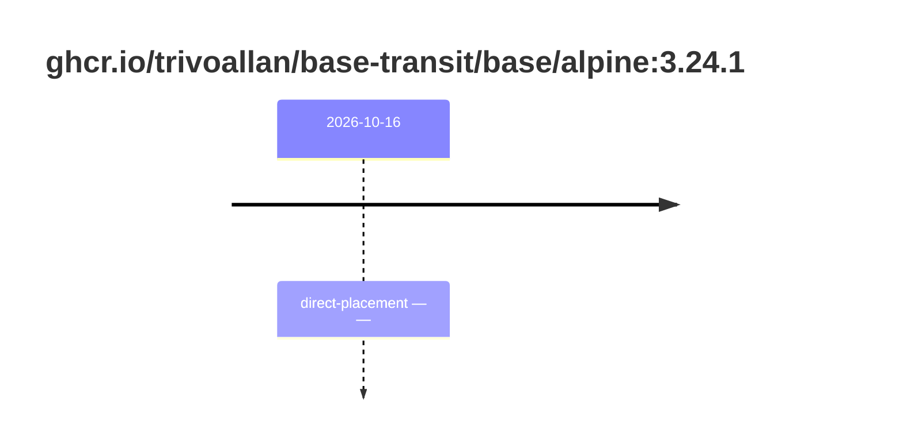

## base-alpine-3 · ghcr.io/trivoallan/base-transit/base/alpine:3.24.1

`sha256:17dbbbe887650be0fc7bee5a9224725369e2ae61ec6129ede49b80c2da7426f2`

| ts | state | reason | ruleset | report | details |
| --- | --- | --- | --- | --- | --- |
| 2026-10-16T15:40:50Z | direct-placement | — | sha256:589dd893ea07b8c07d34a754db225ac0c43b55988cfc42c6631aad77aeeefb40 | `results/reports/base-alpine-3/sha256:17dbbbe887650be0fc7bee5a9224725369e2ae61ec6129ede49b80c2da7426f2.md` | source: sha256:28bd5fe8b56d1bd048e5babf5b10710ebe0bae67db86916198a6eec434943f8b |

---

# ghcr.io/trivoallan/base-transit/base/alpine:sha256:17dbbbe887650be0fc7bee5a9224725369e2ae61ec6129ede49b80c2da7426f2

## 🏷️ Placement direct · 100/100

**9/9 rules · all pass ✓**

**Analysis date:** 2026-10-16T15:40:50.149167+00:00

## Playbook results

| Playbook | Verdict | Failing rules |
| --- | --- | --- |
|  |  | 0 |
