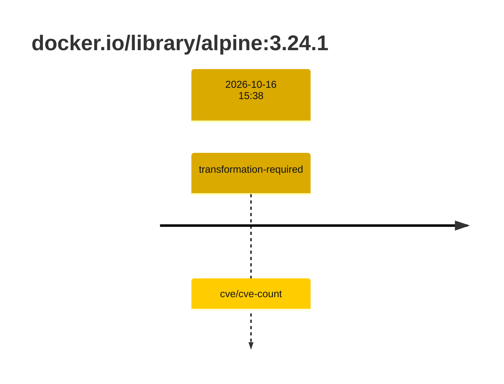
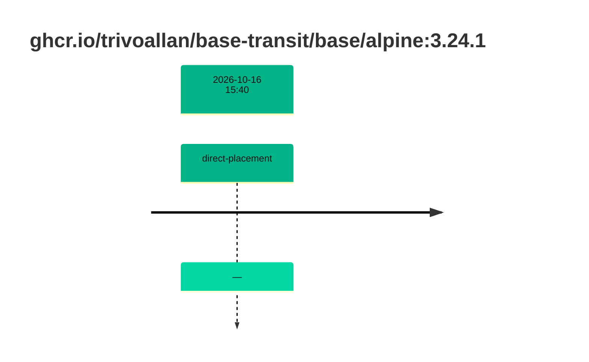

## base-alpine-3 · docker.io/library/alpine:3.24.1

`sha256:28bd5fe8b56d1bd048e5babf5b10710ebe0bae67db86916198a6eec434943f8b`

| ts | run | state | reason | ruleset | report | details |
| --- | --- | --- | --- | --- | --- | --- |
| 2026-10-16T15:38:44Z |  | transformation-required | cve/cve-count | sha256:589dd893ea07b8c07d34a754db225ac0c43b55988cfc42c6631aad77aeeefb40 | `results/reports/base-alpine-3/sha256:28bd5fe8b56d1bd048e5babf5b10710ebe0bae67db86916198a6eec434943f8b.md` |  |

## base-alpine-3 · ghcr.io/trivoallan/base-transit/base/alpine:3.24.1

`sha256:17dbbbe887650be0fc7bee5a9224725369e2ae61ec6129ede49b80c2da7426f2`

| ts | run | state | reason | ruleset | report | details |
| --- | --- | --- | --- | --- | --- | --- |
| 2026-10-16T15:40:50Z |  | direct-placement | — | sha256:589dd893ea07b8c07d34a754db225ac0c43b55988cfc42c6631aad77aeeefb40 | `results/reports/base-alpine-3/sha256:17dbbbe887650be0fc7bee5a9224725369e2ae61ec6129ede49b80c2da7426f2.md` | source: sha256:28bd5fe8b56d1bd048e5babf5b10710ebe0bae67db86916198a6eec434943f8b |

---

<!-- regis -->

# docker.io/library/alpine:sha256:28bd5fe8b56d1bd048e5babf5b10710ebe0bae67db86916198a6eec434943f8b

## 🏷️ Transformation requise puis placement · 56/100

**5/9 rules · 4 failed · worst: 🟥 critical**

| | Rule | Level | Result |
| --- | --- | --- | --- |
| ✗ | cve-critical | critical | Image has 4 critical CVEs (max allowed: 0). |
| ✗ | cve-fixable | warning | Image has 21 vulnerabilities with available fixes. |
| ✗ | cve-high | warning | Image has 23 high CVEs (max allowed: 10). |
| ✗ | freshness | warning | Image is older than 90 days (122 days). |

**Analysis date:** 2026-10-16T15:38:44.278362+00:00

## Playbook results

| Playbook | Verdict | Failing rules |
| --- | --- | --- |
|  |  | 0 |
