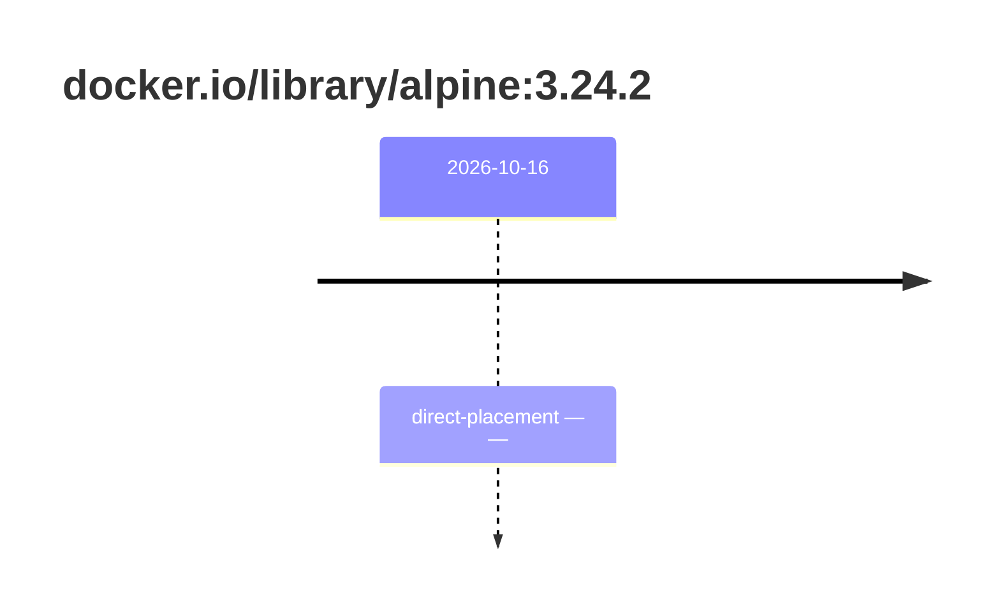

## base-alpine-3 · docker.io/library/alpine:3.24.2

`sha256:294b683cb724975bec92580e1e685676bd4b50bda910ddb8c51d4cabeaec77e6`

| ts | state | reason | ruleset | report | details |
| --- | --- | --- | --- | --- | --- |
| 2026-10-16T15:38:58Z | direct-placement | — | sha256:589dd893ea07b8c07d34a754db225ac0c43b55988cfc42c6631aad77aeeefb40 | `results/reports/base-alpine-3/sha256:294b683cb724975bec92580e1e685676bd4b50bda910ddb8c51d4cabeaec77e6.md` |  |

---

# docker.io/library/alpine:sha256:294b683cb724975bec92580e1e685676bd4b50bda910ddb8c51d4cabeaec77e6

## 🏷️ Placement direct · 89/100

**8/9 rules · 1 failed · worst: 🟧 warning**

| | Rule | Level | Result |
| --- | --- | --- | --- |
| ✗ | cve-fixable | warning | Image has 1 vulnerabilities with available fixes. |

**Analysis date:** 2026-10-16T15:38:57.973836+00:00

## Playbook results

| Playbook | Verdict | Failing rules |
| --- | --- | --- |
|  |  | 0 |
