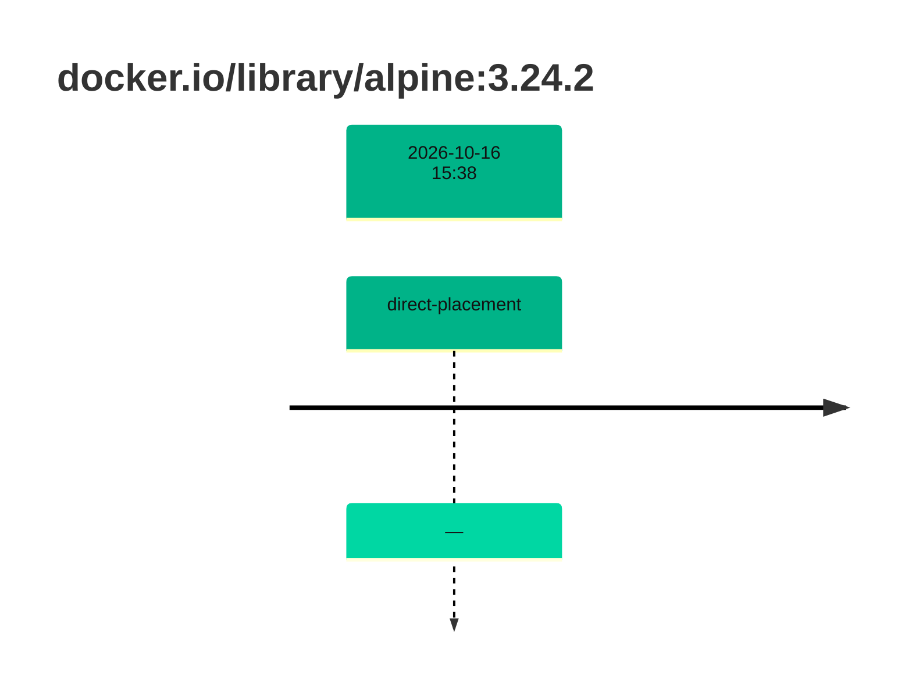
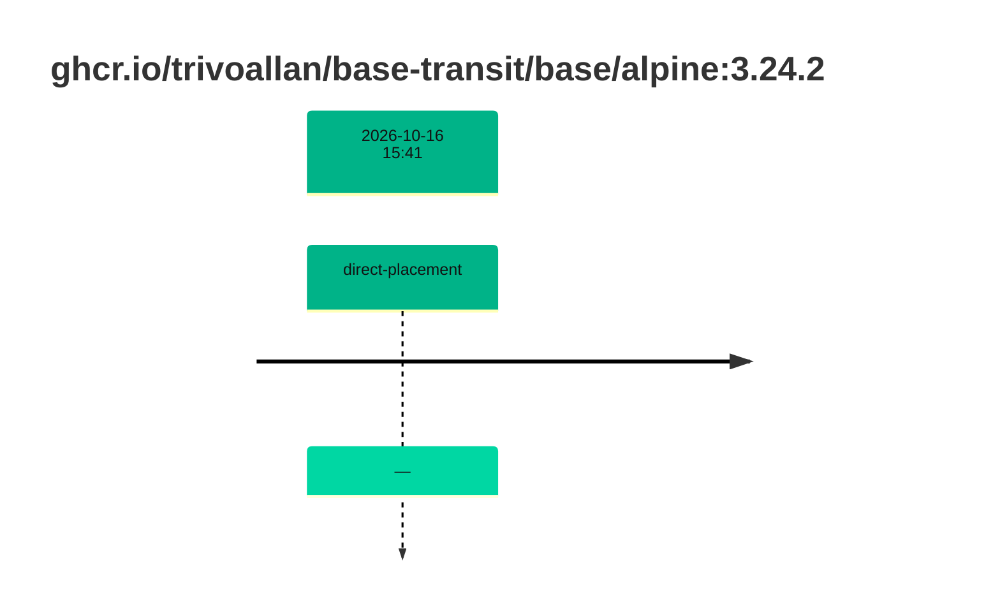

## base-alpine-3 · docker.io/library/alpine:3.24.2

`sha256:294b683cb724975bec92580e1e685676bd4b50bda910ddb8c51d4cabeaec77e6`

| ts | run | state | reason | ruleset | report | details |
| --- | --- | --- | --- | --- | --- | --- |
| 2026-10-16T15:38:58Z |  | direct-placement | — | sha256:589dd893ea07b8c07d34a754db225ac0c43b55988cfc42c6631aad77aeeefb40 | `results/reports/base-alpine-3/sha256:294b683cb724975bec92580e1e685676bd4b50bda910ddb8c51d4cabeaec77e6.md` |  |

## base-alpine-3 · ghcr.io/trivoallan/base-transit/base/alpine:3.24.2

`sha256:5c5d9aab89d2e0bfe7e751d5085de54beb477d4f5c4d051dcfb3896416e67cf5`

| ts | run | state | reason | ruleset | report | details |
| --- | --- | --- | --- | --- | --- | --- |
| 2026-10-16T15:41:00Z |  | direct-placement | — | sha256:589dd893ea07b8c07d34a754db225ac0c43b55988cfc42c6631aad77aeeefb40 | `results/reports/base-alpine-3/sha256:5c5d9aab89d2e0bfe7e751d5085de54beb477d4f5c4d051dcfb3896416e67cf5.md` | source: sha256:294b683cb724975bec92580e1e685676bd4b50bda910ddb8c51d4cabeaec77e6 |

---

<!-- regis -->

# ghcr.io/trivoallan/base-transit/base/alpine:sha256:5c5d9aab89d2e0bfe7e751d5085de54beb477d4f5c4d051dcfb3896416e67cf5

## 🏷️ Placement direct · 100/100

**9/9 rules · all pass ✓**

**Analysis date:** 2026-10-16T15:40:59.618977+00:00

## Playbook results

| Playbook | Verdict | Failing rules |
| --- | --- | --- |
|  |  | 0 |
