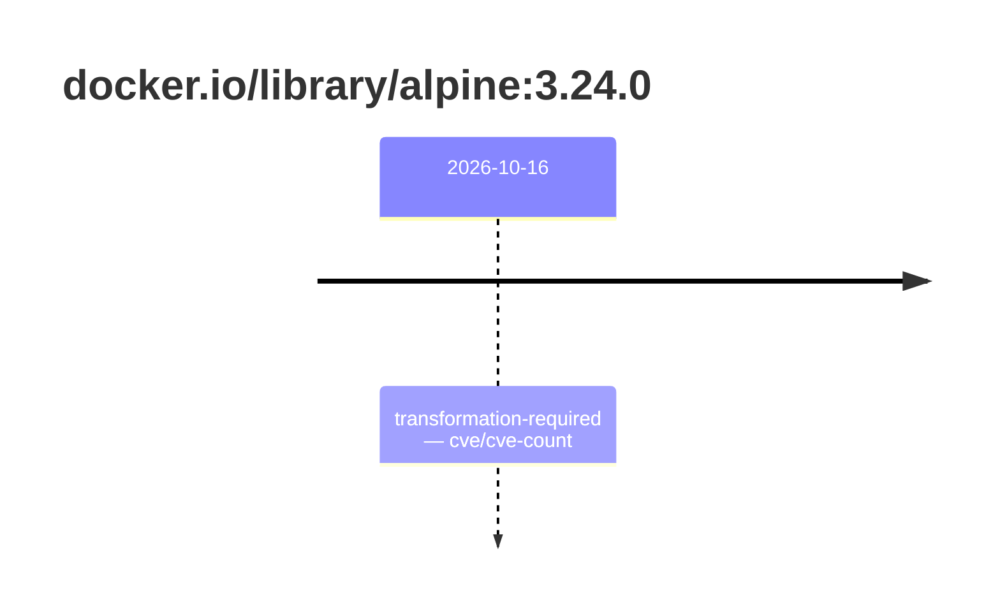

## base-alpine-3 · docker.io/library/alpine:3.24.0

`sha256:a2d49ea686c2adfe3c992e47dc3b5e7fa6e6b5055609400dc2acaeb241c829f4`

| ts | state | reason | ruleset | report | details |
| --- | --- | --- | --- | --- | --- |
| 2026-10-16T15:38:30Z | transformation-required | cve/cve-count | sha256:589dd893ea07b8c07d34a754db225ac0c43b55988cfc42c6631aad77aeeefb40 | `results/reports/base-alpine-3/sha256:a2d49ea686c2adfe3c992e47dc3b5e7fa6e6b5055609400dc2acaeb241c829f4.md` |  |

---

# docker.io/library/alpine:sha256:a2d49ea686c2adfe3c992e47dc3b5e7fa6e6b5055609400dc2acaeb241c829f4

## 🏷️ Transformation requise puis placement · 56/100

**5/9 rules · 4 failed · worst: 🟥 critical**

| | Rule | Level | Result |
| --- | --- | --- | --- |
| ✗ | cve-critical | critical | Image has 6 critical CVEs (max allowed: 0). |
| ✗ | cve-fixable | warning | Image has 51 vulnerabilities with available fixes. |
| ✗ | cve-high | warning | Image has 39 high CVEs (max allowed: 10). |
| ✗ | freshness | warning | Image is older than 90 days (128 days). |

**Analysis date:** 2026-10-16T15:38:30.168069+00:00

## Playbook results

| Playbook | Verdict | Failing rules |
| --- | --- | --- |
|  |  | 0 |
