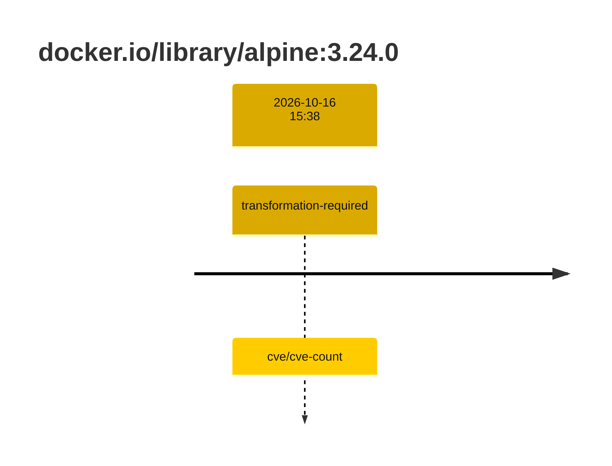
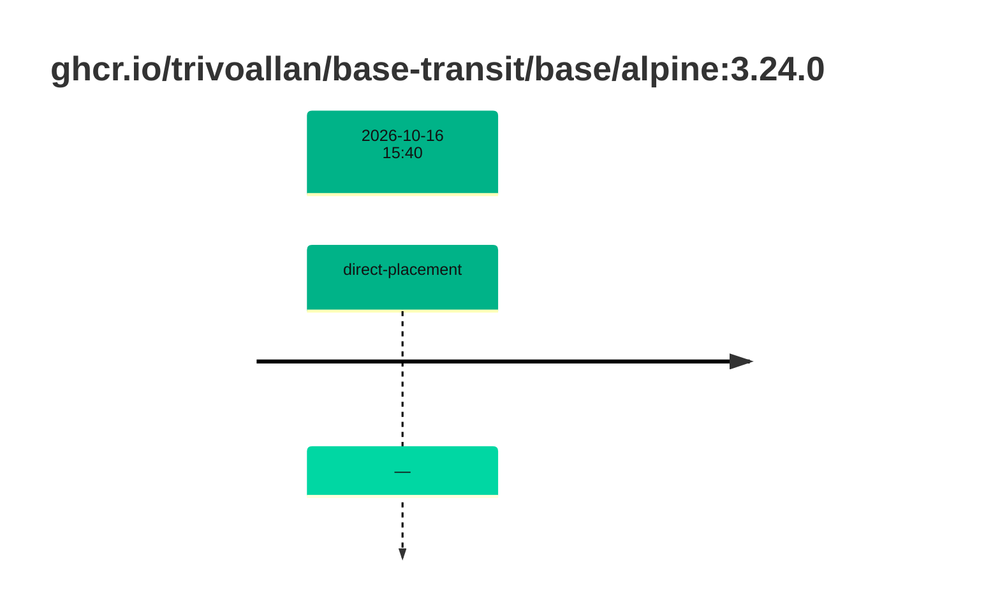

## base-alpine-3 · docker.io/library/alpine:3.24.0

`sha256:a2d49ea686c2adfe3c992e47dc3b5e7fa6e6b5055609400dc2acaeb241c829f4`

| ts | run | state | reason | ruleset | report | details |
| --- | --- | --- | --- | --- | --- | --- |
| 2026-10-16T15:38:30Z |  | transformation-required | cve/cve-count | sha256:589dd893ea07b8c07d34a754db225ac0c43b55988cfc42c6631aad77aeeefb40 | `results/reports/base-alpine-3/sha256:a2d49ea686c2adfe3c992e47dc3b5e7fa6e6b5055609400dc2acaeb241c829f4.md` |  |

## base-alpine-3 · ghcr.io/trivoallan/base-transit/base/alpine:3.24.0

`sha256:b49e90f7a520f25bd3e1f020265bf80e7afae7b1dd1b0a1908672e9b85211200`

| ts | run | state | reason | ruleset | report | details |
| --- | --- | --- | --- | --- | --- | --- |
| 2026-10-16T15:40:41Z |  | direct-placement | — | sha256:589dd893ea07b8c07d34a754db225ac0c43b55988cfc42c6631aad77aeeefb40 | `results/reports/base-alpine-3/sha256:b49e90f7a520f25bd3e1f020265bf80e7afae7b1dd1b0a1908672e9b85211200.md` | source: sha256:a2d49ea686c2adfe3c992e47dc3b5e7fa6e6b5055609400dc2acaeb241c829f4 |

---

<!-- regis -->

# ghcr.io/trivoallan/base-transit/base/alpine:sha256:b49e90f7a520f25bd3e1f020265bf80e7afae7b1dd1b0a1908672e9b85211200

## 🏷️ Placement direct · 100/100

**9/9 rules · all pass ✓**

**Analysis date:** 2026-10-16T15:40:41.233201+00:00

## Playbook results

| Playbook | Verdict | Failing rules |
| --- | --- | --- |
|  |  | 0 |
