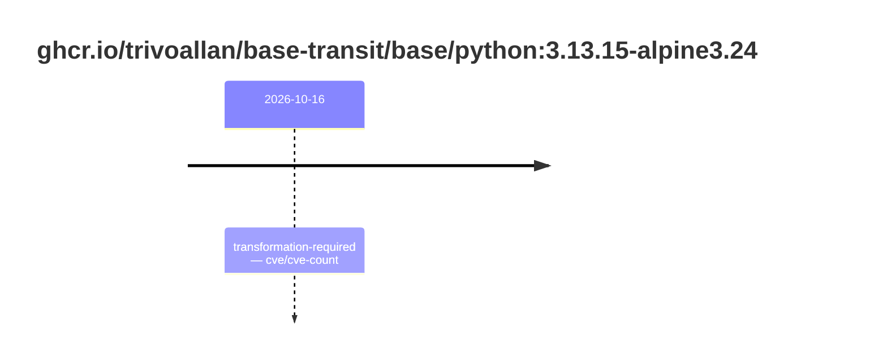
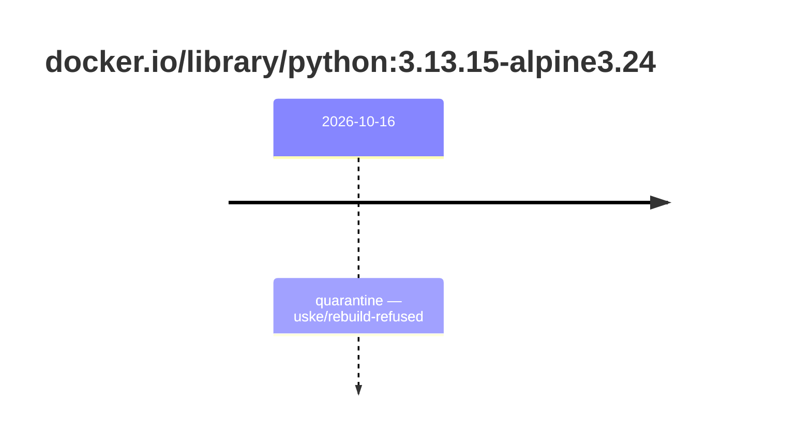

## base-python-3 · ghcr.io/trivoallan/base-transit/base/python:3.13.15-alpine3.24

`sha256:33d9c701fd82efb0351becac53606082ee382017eaeddba7b91d6cf748238f1c`

| ts | state | reason | ruleset | report | details |
| --- | --- | --- | --- | --- | --- |
| 2026-10-16T12:10:43Z | transformation-required | cve/cve-count | sha256:589dd893ea07b8c07d34a754db225ac0c43b55988cfc42c6631aad77aeeefb40 | `results/reports/base-python-3/sha256:33d9c701fd82efb0351becac53606082ee382017eaeddba7b91d6cf748238f1c.md` | source: sha256:79e7a9b9ff1cbceff819f856fb374477792a5967759d94df266de7b7b4120e6f |

## base-python-3 · docker.io/library/python:3.13.15-alpine3.24

`sha256:79e7a9b9ff1cbceff819f856fb374477792a5967759d94df266de7b7b4120e6f`

| ts | state | reason | ruleset | report | details |
| --- | --- | --- | --- | --- | --- |
| 2026-10-16T12:10:43Z | quarantine | uske/rebuild-refused | sha256:589dd893ea07b8c07d34a754db225ac0c43b55988cfc42c6631aad77aeeefb40 | `results/reports/base-python-3/sha256:33d9c701fd82efb0351becac53606082ee382017eaeddba7b91d6cf748238f1c.md` | rebuilt: sha256:33d9c701fd82efb0351becac53606082ee382017eaeddba7b91d6cf748238f1c |

---

<!-- regis -->

# ghcr.io/trivoallan/base-transit/base/python:sha256:33d9c701fd82efb0351becac53606082ee382017eaeddba7b91d6cf748238f1c

## 🏷️ Transformation requise puis placement · 56/100

**5/9 rules · 4 failed · worst: 🟥 critical**

| | Rule | Level | Result |
| --- | --- | --- | --- |
| ✗ | cve-critical | critical | Image has 1 critical CVEs (max allowed: 0). |
| ✗ | bonnes-pratiques | warning | Dockle found 1 FATAL issues (max allowed: 0). |
| ✗ | cve-fixable | warning | Image has 10 vulnerabilities with available fixes. |
| ✗ | secrets-non-verifies | warning | TruffleHog detected 1 secret(s) in the image. |

**Analysis date:** 2026-10-16T12:10:42.823615+00:00

## Playbook results

| Playbook | Verdict | Failing rules |
| --- | --- | --- |
|  |  | 0 |
