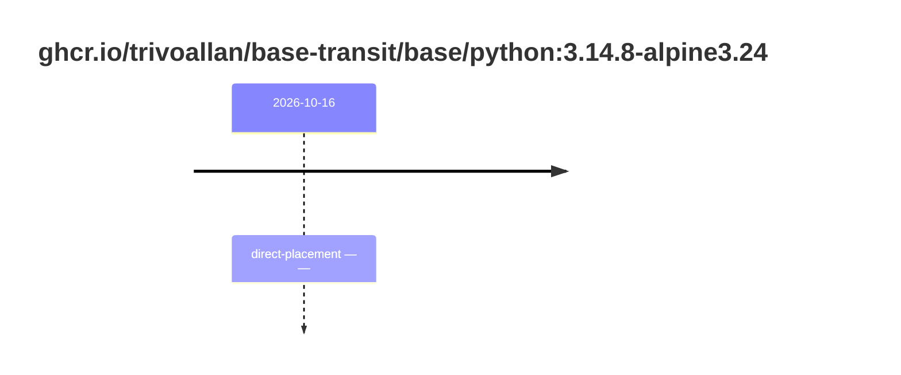

## base-python-3 · ghcr.io/trivoallan/base-transit/base/python:3.14.8-alpine3.24

`sha256:34840e128644c59505f7844378e596571e10583eea5c9378a31f33f42102a01b`

| ts | state | reason | ruleset | report | details |
| --- | --- | --- | --- | --- | --- |
| 2026-10-16T13:23:07Z | direct-placement | — | sha256:589dd893ea07b8c07d34a754db225ac0c43b55988cfc42c6631aad77aeeefb40 | `results/reports/base-python-3/sha256:34840e128644c59505f7844378e596571e10583eea5c9378a31f33f42102a01b.md` | source: sha256:f6a589d43c42b9e7f7dc67a12d37132491f362859a5d750607710cc56da3bc72 |

---

# ghcr.io/trivoallan/base-transit/base/python:sha256:34840e128644c59505f7844378e596571e10583eea5c9378a31f33f42102a01b

## 🏷️ Placement direct · 67/100

**6/9 rules · 3 failed · worst: 🟧 warning**

| | Rule | Level | Result |
| --- | --- | --- | --- |
| ✗ | bonnes-pratiques | warning | Dockle found 1 FATAL issues (max allowed: 0). |
| ✗ | cve-fixable | warning | Image has 2 vulnerabilities with available fixes. |
| ✗ | secrets-non-verifies | warning | TruffleHog detected 1 secret(s) in the image. |

**Analysis date:** 2026-10-16T13:23:07.346164+00:00

## Playbook results

| Playbook | Verdict | Failing rules |
| --- | --- | --- |
|  |  | 0 |
