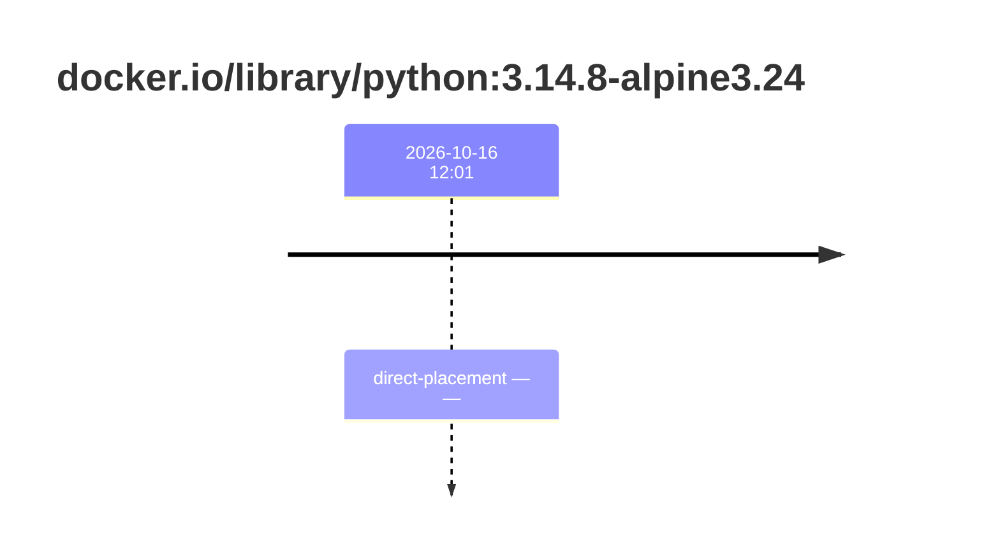
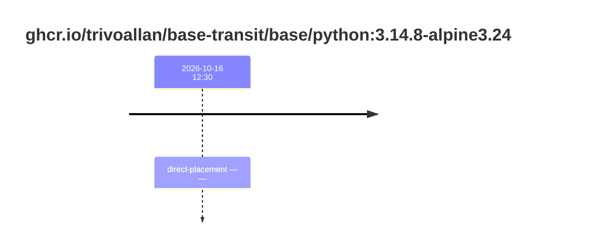

## base-python-3 · docker.io/library/python:3.14.8-alpine3.24

`sha256:f6a589d43c42b9e7f7dc67a12d37132491f362859a5d750607710cc56da3bc72`

| ts | run | state | reason | ruleset | report | details |
| --- | --- | --- | --- | --- | --- | --- |
| 2026-10-16T12:01:39Z |  | direct-placement | — | sha256:589dd893ea07b8c07d34a754db225ac0c43b55988cfc42c6631aad77aeeefb40 | `/results/reports/base-python-3/sha256:f6a589d43c42b9e7f7dc67a12d37132491f362859a5d750607710cc56da3bc72.html` (volume uske-results) |  |

## base-python-3 · ghcr.io/trivoallan/base-transit/base/python:3.14.8-alpine3.24

`sha256:e6f538af1648cb753dbd794f2824d466682dd0123ffd8d58c2b663bc25bbeb87`

| ts | run | state | reason | ruleset | report | details |
| --- | --- | --- | --- | --- | --- | --- |
| 2026-10-16T12:11:35Z |  | direct-placement | — | sha256:589dd893ea07b8c07d34a754db225ac0c43b55988cfc42c6631aad77aeeefb40 | `results/reports/base-python-3/sha256:e6f538af1648cb753dbd794f2824d466682dd0123ffd8d58c2b663bc25bbeb87.md` | source: sha256:f6a589d43c42b9e7f7dc67a12d37132491f362859a5d750607710cc56da3bc72 |

## base-python-3 · ghcr.io/trivoallan/base-transit/base/python:3.14.8-alpine3.24

`sha256:267d3fedc02b43d34b8d74d7d8c8e73dd0d8b7c456fcd6ed47eb46b80368230d`

| ts | run | state | reason | ruleset | report | details |
| --- | --- | --- | --- | --- | --- | --- |
| 2026-10-16T12:17:14Z |  | direct-placement | — | sha256:589dd893ea07b8c07d34a754db225ac0c43b55988cfc42c6631aad77aeeefb40 | `results/reports/base-python-3/sha256:267d3fedc02b43d34b8d74d7d8c8e73dd0d8b7c456fcd6ed47eb46b80368230d.md` | source: sha256:f6a589d43c42b9e7f7dc67a12d37132491f362859a5d750607710cc56da3bc72 |

## base-python-3 · ghcr.io/trivoallan/base-transit/base/python:3.14.8-alpine3.24

`sha256:76c5a61e54c689636e9f4f3e1729bdb46dc30db9417c8617f36a779caa01c2d6`

| ts | run | state | reason | ruleset | report | details |
| --- | --- | --- | --- | --- | --- | --- |
| 2026-10-16T12:30:39Z |  | direct-placement | — | sha256:589dd893ea07b8c07d34a754db225ac0c43b55988cfc42c6631aad77aeeefb40 | `results/reports/base-python-3/sha256:76c5a61e54c689636e9f4f3e1729bdb46dc30db9417c8617f36a779caa01c2d6.md` | source: sha256:f6a589d43c42b9e7f7dc67a12d37132491f362859a5d750607710cc56da3bc72 |

## base-python-3 · ghcr.io/trivoallan/base-transit/base/python:3.14.8-alpine3.24

`sha256:34840e128644c59505f7844378e596571e10583eea5c9378a31f33f42102a01b`

| ts | run | state | reason | ruleset | report | details |
| --- | --- | --- | --- | --- | --- | --- |
| 2026-10-16T13:23:07Z |  | direct-placement | — | sha256:589dd893ea07b8c07d34a754db225ac0c43b55988cfc42c6631aad77aeeefb40 | `results/reports/base-python-3/sha256:34840e128644c59505f7844378e596571e10583eea5c9378a31f33f42102a01b.md` | source: sha256:f6a589d43c42b9e7f7dc67a12d37132491f362859a5d750607710cc56da3bc72 |

---

<!-- regis -->

# ghcr.io/trivoallan/base-transit/base/python:sha256:76c5a61e54c689636e9f4f3e1729bdb46dc30db9417c8617f36a779caa01c2d6

## 🏷️ Placement direct · 67/100

**6/9 rules · 3 failed · worst: 🟧 warning**

| | Rule | Level | Result |
| --- | --- | --- | --- |
| ✗ | bonnes-pratiques | warning | Dockle found 1 FATAL issues (max allowed: 0). |
| ✗ | cve-fixable | warning | Image has 2 vulnerabilities with available fixes. |
| ✗ | secrets-non-verifies | warning | TruffleHog detected 1 secret(s) in the image. |

**Analysis date:** 2026-10-16T12:30:39.309451+00:00

## Playbook results

| Playbook | Verdict | Failing rules |
| --- | --- | --- |
|  |  | 0 |
