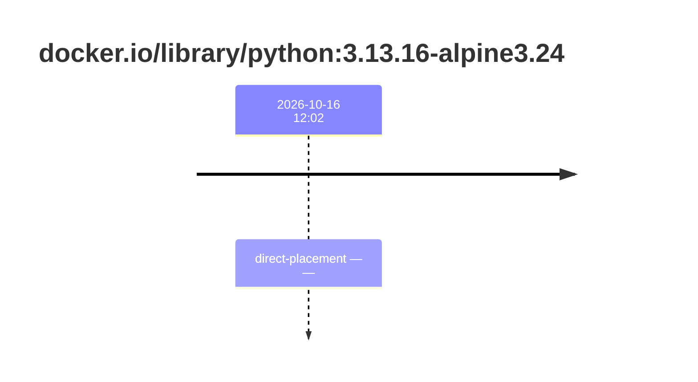
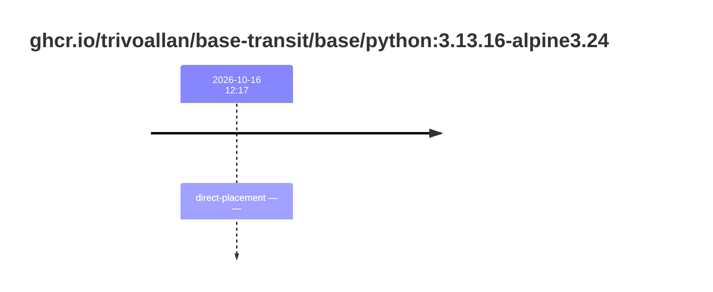

## base-python-3 · docker.io/library/python:3.13.16-alpine3.24

`sha256:2d9aefe2fef018a7eb2c13064c89c71929800fd2e5dccdbf52ea5da5bb8d929a`

| ts | run | state | reason | ruleset | report | details |
| --- | --- | --- | --- | --- | --- | --- |
| 2026-10-16T12:02:22Z |  | direct-placement | — | sha256:589dd893ea07b8c07d34a754db225ac0c43b55988cfc42c6631aad77aeeefb40 | `/results/reports/base-python-3/sha256:2d9aefe2fef018a7eb2c13064c89c71929800fd2e5dccdbf52ea5da5bb8d929a.html` (volume uske-results) |  |

## base-python-3 · ghcr.io/trivoallan/base-transit/base/python:3.13.16-alpine3.24

`sha256:9d22624f81e89f73a84c60a309b9af2a2d8d81a05e79e285e2217b2f947f5205`

| ts | run | state | reason | ruleset | report | details |
| --- | --- | --- | --- | --- | --- | --- |
| 2026-10-16T12:10:56Z |  | direct-placement | — | sha256:589dd893ea07b8c07d34a754db225ac0c43b55988cfc42c6631aad77aeeefb40 | `results/reports/base-python-3/sha256:9d22624f81e89f73a84c60a309b9af2a2d8d81a05e79e285e2217b2f947f5205.md` | source: sha256:2d9aefe2fef018a7eb2c13064c89c71929800fd2e5dccdbf52ea5da5bb8d929a |

## base-python-3 · ghcr.io/trivoallan/base-transit/base/python:3.13.16-alpine3.24

`sha256:a0d5f0432f3392d2cf5153d7b30d1a2ed2890c973a31c9e827197c90e1ba9c9c`

| ts | run | state | reason | ruleset | report | details |
| --- | --- | --- | --- | --- | --- | --- |
| 2026-10-16T12:17:01Z |  | direct-placement | — | sha256:589dd893ea07b8c07d34a754db225ac0c43b55988cfc42c6631aad77aeeefb40 | `results/reports/base-python-3/sha256:a0d5f0432f3392d2cf5153d7b30d1a2ed2890c973a31c9e827197c90e1ba9c9c.md` | source: sha256:2d9aefe2fef018a7eb2c13064c89c71929800fd2e5dccdbf52ea5da5bb8d929a |

## base-python-3 · ghcr.io/trivoallan/base-transit/base/python:3.13.16-alpine3.24

`sha256:7a464ee67f42dd8bfc97b1c37301fce7f57217b42bccaa016630c2ebf5b41d5c`

| ts | run | state | reason | ruleset | report | details |
| --- | --- | --- | --- | --- | --- | --- |
| 2026-10-16T12:30:30Z |  | direct-placement | — | sha256:589dd893ea07b8c07d34a754db225ac0c43b55988cfc42c6631aad77aeeefb40 | `results/reports/base-python-3/sha256:7a464ee67f42dd8bfc97b1c37301fce7f57217b42bccaa016630c2ebf5b41d5c.md` | source: sha256:2d9aefe2fef018a7eb2c13064c89c71929800fd2e5dccdbf52ea5da5bb8d929a |

---

<!-- regis -->

# ghcr.io/trivoallan/base-transit/base/python:sha256:a0d5f0432f3392d2cf5153d7b30d1a2ed2890c973a31c9e827197c90e1ba9c9c

## 🏷️ Placement direct · 67/100

**6/9 rules · 3 failed · worst: 🟧 warning**

| | Rule | Level | Result |
| --- | --- | --- | --- |
| ✗ | bonnes-pratiques | warning | Dockle found 1 FATAL issues (max allowed: 0). |
| ✗ | cve-fixable | warning | Image has 2 vulnerabilities with available fixes. |
| ✗ | secrets-non-verifies | warning | TruffleHog detected 1 secret(s) in the image. |

**Analysis date:** 2026-10-16T12:17:00.990265+00:00

## Playbook results

| Playbook | Verdict | Failing rules |
| --- | --- | --- |
|  |  | 0 |
