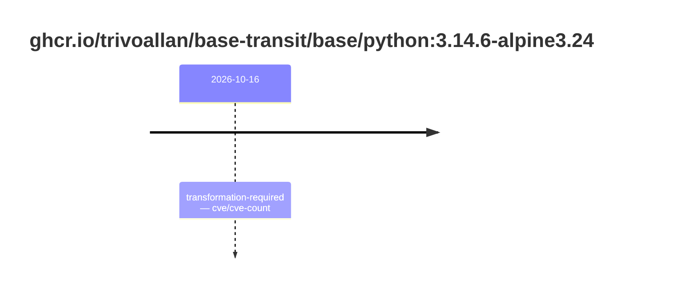
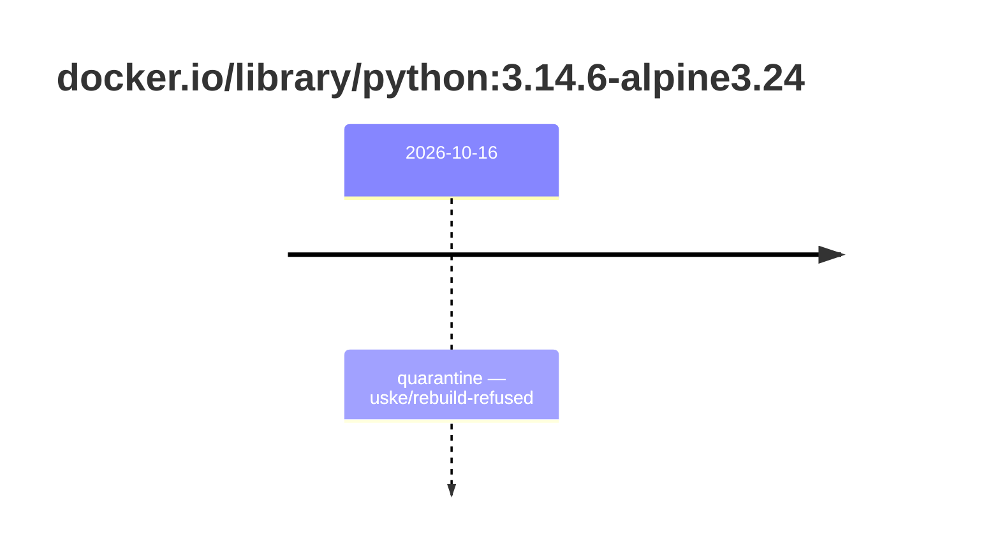

## base-python-3 · ghcr.io/trivoallan/base-transit/base/python:3.14.6-alpine3.24

`sha256:df76c26acfd5720410ad9ff0a05ed7985f4ea6fc1e4bc52b766b113583eaa0a6`

| ts | state | reason | ruleset | report | details |
| --- | --- | --- | --- | --- | --- |
| 2026-10-16T12:11:09Z | transformation-required | cve/cve-count | sha256:589dd893ea07b8c07d34a754db225ac0c43b55988cfc42c6631aad77aeeefb40 | `results/reports/base-python-3/sha256:df76c26acfd5720410ad9ff0a05ed7985f4ea6fc1e4bc52b766b113583eaa0a6.md` | source: sha256:26730869004e2b9c4b9ad09cab8625e81d256d1ce97e72df5520e806b1709f92 |

## base-python-3 · docker.io/library/python:3.14.6-alpine3.24

`sha256:26730869004e2b9c4b9ad09cab8625e81d256d1ce97e72df5520e806b1709f92`

| ts | state | reason | ruleset | report | details |
| --- | --- | --- | --- | --- | --- |
| 2026-10-16T12:11:09Z | quarantine | uske/rebuild-refused | sha256:589dd893ea07b8c07d34a754db225ac0c43b55988cfc42c6631aad77aeeefb40 | `results/reports/base-python-3/sha256:df76c26acfd5720410ad9ff0a05ed7985f4ea6fc1e4bc52b766b113583eaa0a6.md` | rebuilt: sha256:df76c26acfd5720410ad9ff0a05ed7985f4ea6fc1e4bc52b766b113583eaa0a6 |

---

# ghcr.io/trivoallan/base-transit/base/python:sha256:df76c26acfd5720410ad9ff0a05ed7985f4ea6fc1e4bc52b766b113583eaa0a6

## 🏷️ Transformation requise puis placement · 56/100

**5/9 rules · 4 failed · worst: 🟥 critical**

| | Rule | Level | Result |
| --- | --- | --- | --- |
| ✗ | cve-critical | critical | Image has 1 critical CVEs (max allowed: 0). |
| ✗ | bonnes-pratiques | warning | Dockle found 1 FATAL issues (max allowed: 0). |
| ✗ | cve-fixable | warning | Image has 18 vulnerabilities with available fixes. |
| ✗ | secrets-non-verifies | warning | TruffleHog detected 1 secret(s) in the image. |

**Analysis date:** 2026-10-16T12:11:09.145911+00:00

## Playbook results

| Playbook | Verdict | Failing rules |
| --- | --- | --- |
|  |  | 0 |
