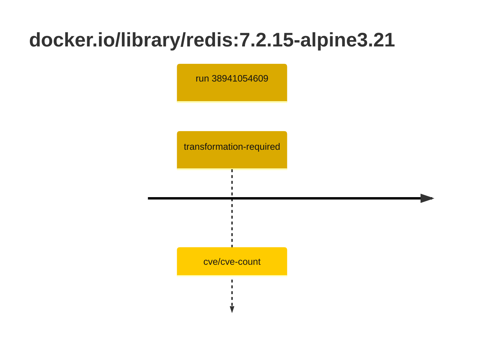
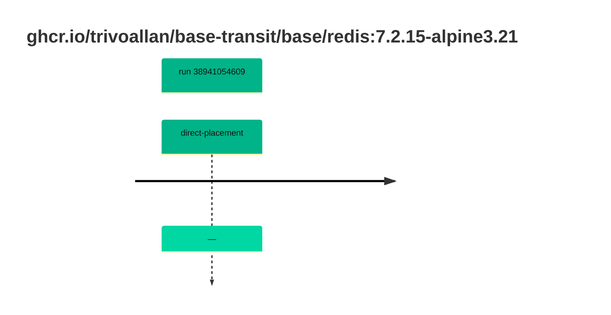

## base-redis-7 · docker.io/library/redis:7.2.15-alpine3.21

`sha256:05a97a479bc73de66f087dc05b569010772880f778cc8671fa6b8aadee32e5c6`

| ts | run | state | reason | ruleset | report | details |
| --- | --- | --- | --- | --- | --- | --- |
| 2026-10-16T17:40:21Z | [38941054609](https://github.com/trivoallan/base-images/actions/runs/38941054609) | transformation-required | cve/cve-count | sha256:589dd893ea07b8c07d34a754db225ac0c43b55988cfc42c6631aad77aeeefb40 | `results/reports/base-redis-7/sha256:05a97a479bc73de66f087dc05b569010772880f778cc8671fa6b8aadee32e5c6.md` |  |

## base-redis-7 · ghcr.io/trivoallan/base-transit/base/redis:7.2.15-alpine3.21

`sha256:e46fbca6d8bf12e777654ad7b9dbc2e75fbc18dd038f8277f85ecd4a4fced654`

| ts | run | state | reason | ruleset | report | details |
| --- | --- | --- | --- | --- | --- | --- |
| 2026-10-16T17:45:49Z | [38941054609](https://github.com/trivoallan/base-images/actions/runs/38941054609) | direct-placement | — | sha256:589dd893ea07b8c07d34a754db225ac0c43b55988cfc42c6631aad77aeeefb40 | `results/reports/base-redis-7/sha256:e46fbca6d8bf12e777654ad7b9dbc2e75fbc18dd038f8277f85ecd4a4fced654.md` | source: sha256:05a97a479bc73de66f087dc05b569010772880f778cc8671fa6b8aadee32e5c6 |

---

<!-- regis -->
# docker.io/library/redis:sha256:05a97a479bc73de66f087dc05b569010772880f778cc8671fa6b8aadee32e5c6

## 🏷️ Transformation requise puis placement · 56/100

**5/9 rules · 4 failed · worst: 🟥 critical**

| | Rule | Level | Result |
| --- | --- | --- | --- |
| ✗ | cve-critical | critical | Image has 6 critical CVEs (max allowed: 0). |
| ✗ | bonnes-pratiques | warning | Dockle found 1 FATAL issues (max allowed: 0). |
| ✗ | cve-fixable | warning | Image has 47 vulnerabilities with available fixes. |
| ✗ | cve-high | warning | Image has 19 high CVEs (max allowed: 10). |

**Analysis date:** 2026-10-16T17:40:20.608050+00:00

## Playbook results

| Playbook | Verdict | Failing rules |
| --- | --- | --- |
|  |  | 0 |
