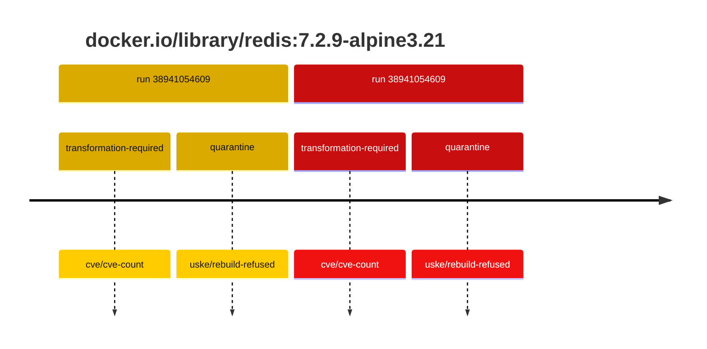
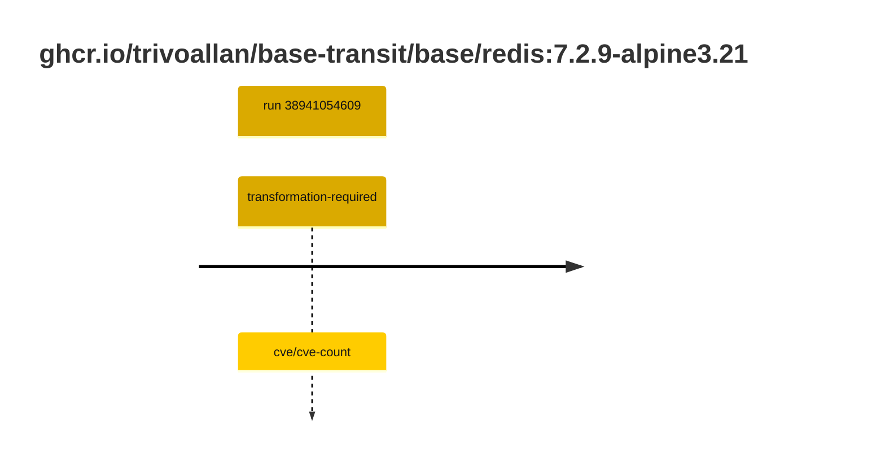

## base-redis-7 · docker.io/library/redis:7.2.9-alpine3.21

`sha256:fce236b99c58ef7196c4e243e43f533b404d5c17239cae4e6e262b729a1952b3`

| ts | run | state | reason | ruleset | report | details |
| --- | --- | --- | --- | --- | --- | --- |
| 2026-10-16T17:39:19Z | [38941054609](https://github.com/trivoallan/base-images/actions/runs/38941054609) | transformation-required | cve/cve-count | sha256:589dd893ea07b8c07d34a754db225ac0c43b55988cfc42c6631aad77aeeefb40 | `results/reports/base-redis-7/sha256:fce236b99c58ef7196c4e243e43f533b404d5c17239cae4e6e262b729a1952b3.md` |  |
| 2026-10-16T17:46:26Z | [38941054609](https://github.com/trivoallan/base-images/actions/runs/38941054609) | quarantine | uske/rebuild-refused | sha256:589dd893ea07b8c07d34a754db225ac0c43b55988cfc42c6631aad77aeeefb40 | `results/reports/base-redis-7/sha256:0a39f3d045d8451755896bc2d3fb126185d32f39cb720b467703c6da285a9709.md` | rebuilt: sha256:0a39f3d045d8451755896bc2d3fb126185d32f39cb720b467703c6da285a9709 |

## base-redis-7 · ghcr.io/trivoallan/base-transit/base/redis:7.2.9-alpine3.21

`sha256:0a39f3d045d8451755896bc2d3fb126185d32f39cb720b467703c6da285a9709`

| ts | run | state | reason | ruleset | report | details |
| --- | --- | --- | --- | --- | --- | --- |
| 2026-10-16T17:46:26Z | [38941054609](https://github.com/trivoallan/base-images/actions/runs/38941054609) | transformation-required | cve/cve-count | sha256:589dd893ea07b8c07d34a754db225ac0c43b55988cfc42c6631aad77aeeefb40 | `results/reports/base-redis-7/sha256:0a39f3d045d8451755896bc2d3fb126185d32f39cb720b467703c6da285a9709.md` | source: sha256:fce236b99c58ef7196c4e243e43f533b404d5c17239cae4e6e262b729a1952b3 |

---

<!-- regis -->
# ghcr.io/trivoallan/base-transit/base/redis:sha256:0a39f3d045d8451755896bc2d3fb126185d32f39cb720b467703c6da285a9709

## 🏷️ Transformation requise puis placement · 56/100

**5/9 rules · 4 failed · worst: 🟥 critical**

| | Rule | Level | Result |
| --- | --- | --- | --- |
| ✗ | cve-critical | critical | Image has 19 critical CVEs (max allowed: 0). |
| ✗ | bonnes-pratiques | warning | Dockle found 1 FATAL issues (max allowed: 0). |
| ✗ | cve-fixable | warning | Image has 268 vulnerabilities with available fixes. |
| ✗ | cve-high | warning | Image has 149 high CVEs (max allowed: 10). |

**Analysis date:** 2026-10-16T17:46:25.553160+00:00

## Playbook results

| Playbook | Verdict | Failing rules |
| --- | --- | --- |
|  |  | 0 |
