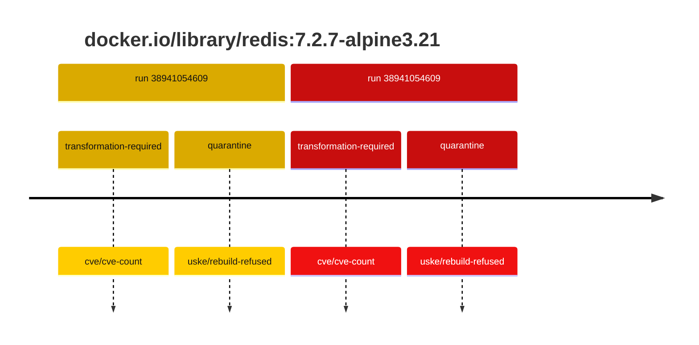
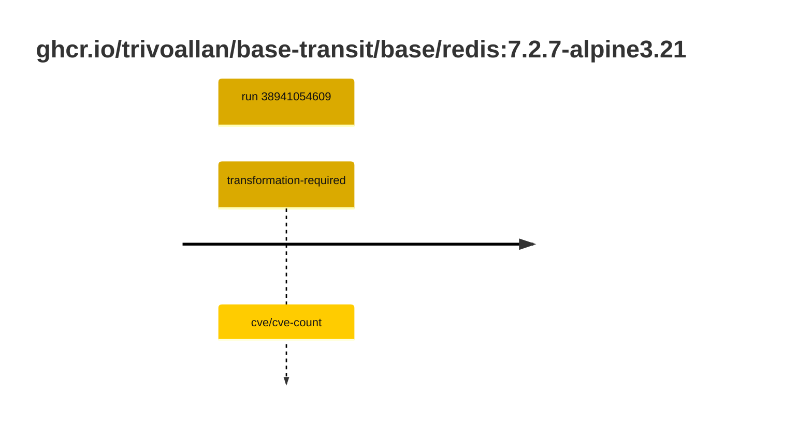

## base-redis-7 · docker.io/library/redis:7.2.7-alpine3.21

`sha256:ddd16a9b1575a774c7e62956be8daa1de5b32cfb5c25b7a216aefed8e0919f9b`

| ts | run | state | reason | ruleset | report | details |
| --- | --- | --- | --- | --- | --- | --- |
| 2026-10-16T17:38:58Z | [38941054609](https://github.com/trivoallan/base-images/actions/runs/38941054609) | transformation-required | cve/cve-count | sha256:589dd893ea07b8c07d34a754db225ac0c43b55988cfc42c6631aad77aeeefb40 | `results/reports/base-redis-7/sha256:ddd16a9b1575a774c7e62956be8daa1de5b32cfb5c25b7a216aefed8e0919f9b.md` |  |
| 2026-10-16T17:46:07Z | [38941054609](https://github.com/trivoallan/base-images/actions/runs/38941054609) | quarantine | uske/rebuild-refused | sha256:589dd893ea07b8c07d34a754db225ac0c43b55988cfc42c6631aad77aeeefb40 | `results/reports/base-redis-7/sha256:1ce15d4fbfbc5e9f1a00f250a2d90cca968efad9cea6a02a4a86438c5ab45477.md` | rebuilt: sha256:1ce15d4fbfbc5e9f1a00f250a2d90cca968efad9cea6a02a4a86438c5ab45477 |

## base-redis-7 · ghcr.io/trivoallan/base-transit/base/redis:7.2.7-alpine3.21

`sha256:1ce15d4fbfbc5e9f1a00f250a2d90cca968efad9cea6a02a4a86438c5ab45477`

| ts | run | state | reason | ruleset | report | details |
| --- | --- | --- | --- | --- | --- | --- |
| 2026-10-16T17:46:07Z | [38941054609](https://github.com/trivoallan/base-images/actions/runs/38941054609) | transformation-required | cve/cve-count | sha256:589dd893ea07b8c07d34a754db225ac0c43b55988cfc42c6631aad77aeeefb40 | `results/reports/base-redis-7/sha256:1ce15d4fbfbc5e9f1a00f250a2d90cca968efad9cea6a02a4a86438c5ab45477.md` | source: sha256:ddd16a9b1575a774c7e62956be8daa1de5b32cfb5c25b7a216aefed8e0919f9b |

---

<!-- regis -->
# ghcr.io/trivoallan/base-transit/base/redis:sha256:1ce15d4fbfbc5e9f1a00f250a2d90cca968efad9cea6a02a4a86438c5ab45477

## 🏷️ Transformation requise puis placement · 56/100

**5/9 rules · 4 failed · worst: 🟥 critical**

| | Rule | Level | Result |
| --- | --- | --- | --- |
| ✗ | cve-critical | critical | Image has 20 critical CVEs (max allowed: 0). |
| ✗ | bonnes-pratiques | warning | Dockle found 1 FATAL issues (max allowed: 0). |
| ✗ | cve-fixable | warning | Image has 270 vulnerabilities with available fixes. |
| ✗ | cve-high | warning | Image has 150 high CVEs (max allowed: 10). |

**Analysis date:** 2026-10-16T17:46:07.175824+00:00

## Playbook results

| Playbook | Verdict | Failing rules |
| --- | --- | --- |
|  |  | 0 |
