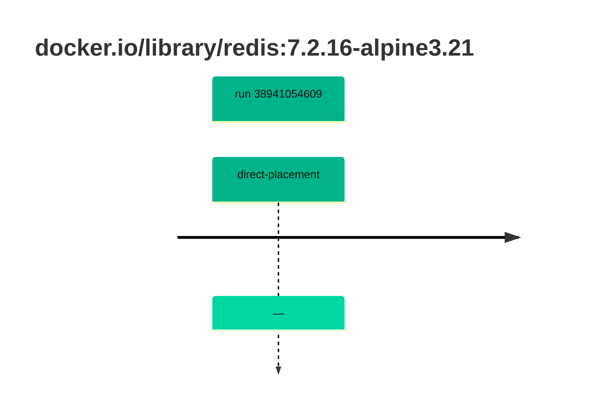

## base-redis-7 · docker.io/library/redis:7.2.16-alpine3.21

`sha256:29e8589c3f9ba699b5f7aa4b3c7733c58852a3626439e619aa0ee78de08c6ca0`

| ts | run | state | reason | ruleset | report | details |
| --- | --- | --- | --- | --- | --- | --- |
| 2026-10-16T17:40:33Z | [38941054609](https://github.com/trivoallan/base-images/actions/runs/38941054609) | direct-placement | — | sha256:589dd893ea07b8c07d34a754db225ac0c43b55988cfc42c6631aad77aeeefb40 | `results/reports/base-redis-7/sha256:29e8589c3f9ba699b5f7aa4b3c7733c58852a3626439e619aa0ee78de08c6ca0.md` |  |

---

<!-- regis -->
# docker.io/library/redis:sha256:29e8589c3f9ba699b5f7aa4b3c7733c58852a3626439e619aa0ee78de08c6ca0

## 🏷️ Placement direct · 78/100

**7/9 rules · 2 failed · worst: 🟧 warning**

| | Rule | Level | Result |
| --- | --- | --- | --- |
| ✗ | bonnes-pratiques | warning | Dockle found 1 FATAL issues (max allowed: 0). |
| ✗ | cve-fixable | warning | Image has 21 vulnerabilities with available fixes. |

**Analysis date:** 2026-10-16T17:40:33.034736+00:00

## Playbook results

| Playbook | Verdict | Failing rules |
| --- | --- | --- |
|  |  | 0 |
