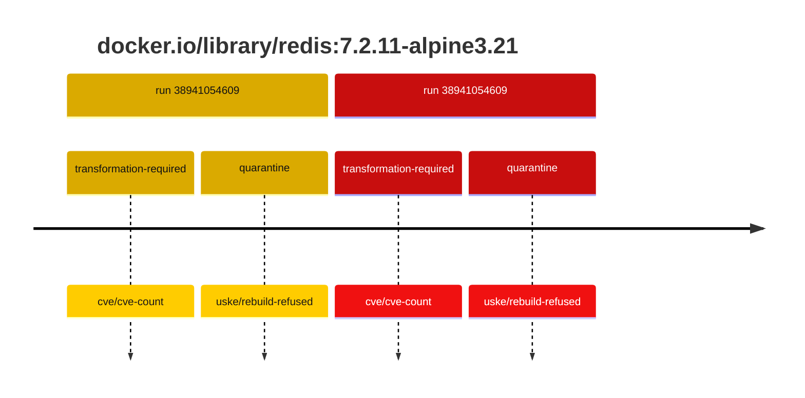
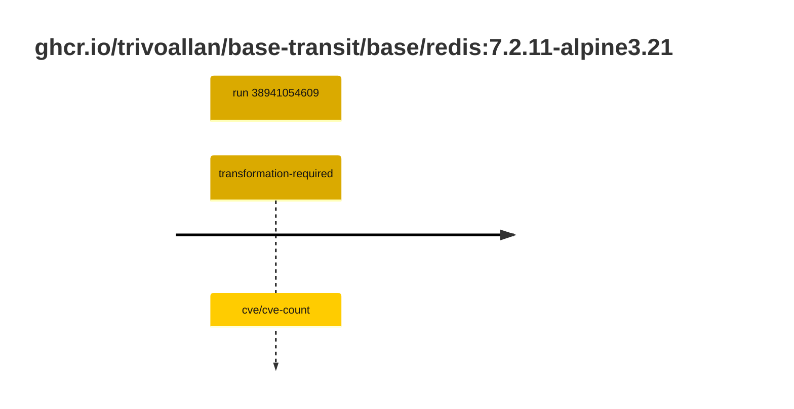

## base-redis-7 · docker.io/library/redis:7.2.11-alpine3.21

`sha256:1a34bdba051ecd8a58ec8a3cc460acef697a1605e918149cc53d920673c1a0a7`

| ts | run | state | reason | ruleset | report | details |
| --- | --- | --- | --- | --- | --- | --- |
| 2026-10-16T17:39:39Z | [38941054609](https://github.com/trivoallan/base-images/actions/runs/38941054609) | transformation-required | cve/cve-count | sha256:589dd893ea07b8c07d34a754db225ac0c43b55988cfc42c6631aad77aeeefb40 | `results/reports/base-redis-7/sha256:1a34bdba051ecd8a58ec8a3cc460acef697a1605e918149cc53d920673c1a0a7.md` |  |
| 2026-10-16T17:45:13Z | [38941054609](https://github.com/trivoallan/base-images/actions/runs/38941054609) | quarantine | uske/rebuild-refused | sha256:589dd893ea07b8c07d34a754db225ac0c43b55988cfc42c6631aad77aeeefb40 | `results/reports/base-redis-7/sha256:6980d11b1a0035989f05071005739f3fca4f2bc957497bc7e5cbf4369e542cd4.md` | rebuilt: sha256:6980d11b1a0035989f05071005739f3fca4f2bc957497bc7e5cbf4369e542cd4 |

## base-redis-7 · ghcr.io/trivoallan/base-transit/base/redis:7.2.11-alpine3.21

`sha256:6980d11b1a0035989f05071005739f3fca4f2bc957497bc7e5cbf4369e542cd4`

| ts | run | state | reason | ruleset | report | details |
| --- | --- | --- | --- | --- | --- | --- |
| 2026-10-16T17:45:13Z | [38941054609](https://github.com/trivoallan/base-images/actions/runs/38941054609) | transformation-required | cve/cve-count | sha256:589dd893ea07b8c07d34a754db225ac0c43b55988cfc42c6631aad77aeeefb40 | `results/reports/base-redis-7/sha256:6980d11b1a0035989f05071005739f3fca4f2bc957497bc7e5cbf4369e542cd4.md` | source: sha256:1a34bdba051ecd8a58ec8a3cc460acef697a1605e918149cc53d920673c1a0a7 |

---

<!-- regis -->
# ghcr.io/trivoallan/base-transit/base/redis:sha256:6980d11b1a0035989f05071005739f3fca4f2bc957497bc7e5cbf4369e542cd4

## 🏷️ Transformation requise puis placement · 56/100

**5/9 rules · 4 failed · worst: 🟥 critical**

| | Rule | Level | Result |
| --- | --- | --- | --- |
| ✗ | cve-critical | critical | Image has 18 critical CVEs (max allowed: 0). |
| ✗ | bonnes-pratiques | warning | Dockle found 1 FATAL issues (max allowed: 0). |
| ✗ | cve-fixable | warning | Image has 262 vulnerabilities with available fixes. |
| ✗ | cve-high | warning | Image has 144 high CVEs (max allowed: 10). |

**Analysis date:** 2026-10-16T17:45:13.069587+00:00

## Playbook results

| Playbook | Verdict | Failing rules |
| --- | --- | --- |
|  |  | 0 |
