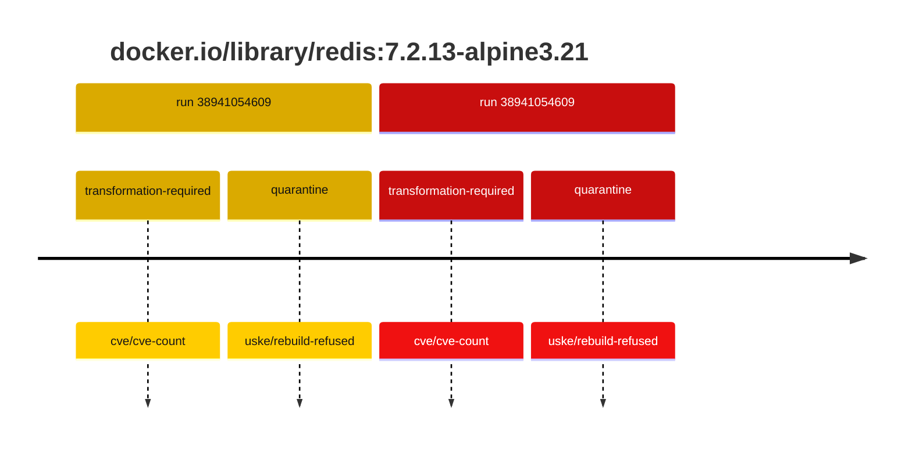
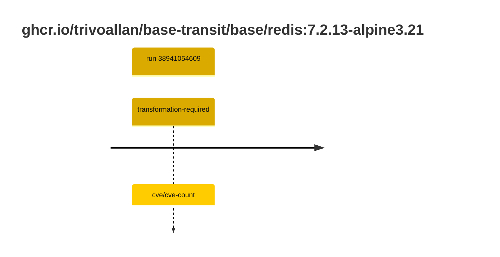

## base-redis-7 · docker.io/library/redis:7.2.13-alpine3.21

`sha256:9907ac0c435717b4d95697cb4d0ce77d100b1d21269a01a0ce66f27335184c38`

| ts | run | state | reason | ruleset | report | details |
| --- | --- | --- | --- | --- | --- | --- |
| 2026-10-16T17:40:00Z | [38941054609](https://github.com/trivoallan/base-images/actions/runs/38941054609) | transformation-required | cve/cve-count | sha256:589dd893ea07b8c07d34a754db225ac0c43b55988cfc42c6631aad77aeeefb40 | `results/reports/base-redis-7/sha256:9907ac0c435717b4d95697cb4d0ce77d100b1d21269a01a0ce66f27335184c38.md` |  |
| 2026-10-16T17:45:31Z | [38941054609](https://github.com/trivoallan/base-images/actions/runs/38941054609) | quarantine | uske/rebuild-refused | sha256:589dd893ea07b8c07d34a754db225ac0c43b55988cfc42c6631aad77aeeefb40 | `results/reports/base-redis-7/sha256:21fb8c60514e950ee6168cf850520ef8284ed4c2c7534da1c7e499d4e3442840.md` | rebuilt: sha256:21fb8c60514e950ee6168cf850520ef8284ed4c2c7534da1c7e499d4e3442840 |

## base-redis-7 · ghcr.io/trivoallan/base-transit/base/redis:7.2.13-alpine3.21

`sha256:21fb8c60514e950ee6168cf850520ef8284ed4c2c7534da1c7e499d4e3442840`

| ts | run | state | reason | ruleset | report | details |
| --- | --- | --- | --- | --- | --- | --- |
| 2026-10-16T17:45:31Z | [38941054609](https://github.com/trivoallan/base-images/actions/runs/38941054609) | transformation-required | cve/cve-count | sha256:589dd893ea07b8c07d34a754db225ac0c43b55988cfc42c6631aad77aeeefb40 | `results/reports/base-redis-7/sha256:21fb8c60514e950ee6168cf850520ef8284ed4c2c7534da1c7e499d4e3442840.md` | source: sha256:9907ac0c435717b4d95697cb4d0ce77d100b1d21269a01a0ce66f27335184c38 |

---

<!-- regis -->
# docker.io/library/redis:sha256:9907ac0c435717b4d95697cb4d0ce77d100b1d21269a01a0ce66f27335184c38

## 🏷️ Transformation requise puis placement · 44/100

**4/9 rules · 5 failed · worst: 🟥 critical**

| | Rule | Level | Result |
| --- | --- | --- | --- |
| ✗ | cve-critical | critical | Image has 24 critical CVEs (max allowed: 0). |
| ✗ | bonnes-pratiques | warning | Dockle found 1 FATAL issues (max allowed: 0). |
| ✗ | cve-fixable | warning | Image has 309 vulnerabilities with available fixes. |
| ✗ | cve-high | warning | Image has 163 high CVEs (max allowed: 10). |
| ✗ | freshness | warning | Image is older than 90 days (182 days). |

**Analysis date:** 2026-10-16T17:39:59.942008+00:00

## Playbook results

| Playbook | Verdict | Failing rules |
| --- | --- | --- |
|  |  | 0 |
