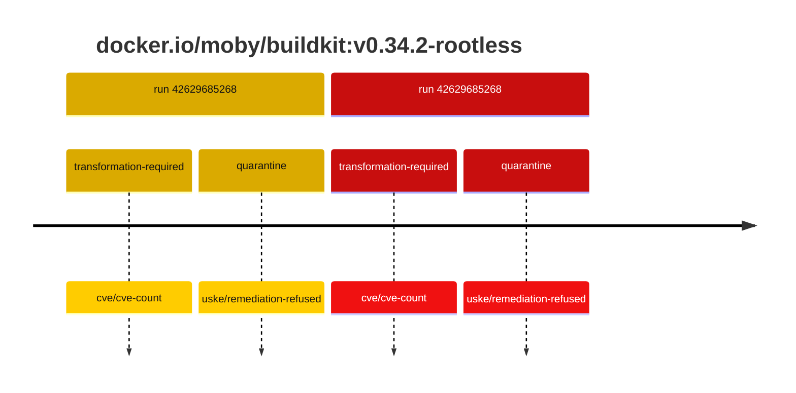
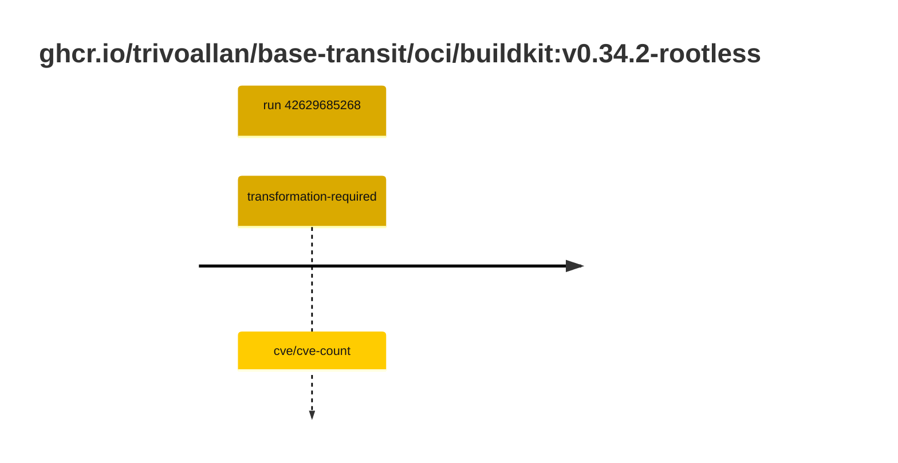

## buildkit-0 · docker.io/moby/buildkit:v0.34.2-rootless

`sha256:c8252268760e1baba80780d63d738ef9f260fb7c7c0973c78494cb9ddd99eda1`

| ts | run | state | reason | ruleset | report | details |
| --- | --- | --- | --- | --- | --- | --- |
| 2026-11-09T14:05:40Z | [42629685268](https://github.com/trivoallan/base-images/actions/runs/42629685268) | transformation-required | cve/cve-count | sha256:7d034c36a6153b33b76e2b2f7b4d84678e9d65039092cf8c67467d573f20ba84 | `results/reports/buildkit-0/sha256:c8252268760e1baba80780d63d738ef9f260fb7c7c0973c78494cb9ddd99eda1/42629685268-1.md` | repairable: true |
| 2026-11-09T14:07:32Z | [42629685268](https://github.com/trivoallan/base-images/actions/runs/42629685268) | quarantine | uske/remediation-refused | sha256:7d034c36a6153b33b76e2b2f7b4d84678e9d65039092cf8c67467d573f20ba84 | `results/reports/buildkit-0/sha256:38e2d188adaf5971f9d98a31880857d24257dd2744ec888dd89420b5c6770aad/42629685268-1.md` | rebuilt: sha256:38e2d188adaf5971f9d98a31880857d24257dd2744ec888dd89420b5c6770aad |

## buildkit-0 · ghcr.io/trivoallan/base-transit/oci/buildkit:v0.34.2-rootless

`sha256:38e2d188adaf5971f9d98a31880857d24257dd2744ec888dd89420b5c6770aad`

| ts | run | state | reason | ruleset | report | details |
| --- | --- | --- | --- | --- | --- | --- |
| 2026-11-09T14:07:32Z | [42629685268](https://github.com/trivoallan/base-images/actions/runs/42629685268) | transformation-required | cve/cve-count | sha256:7d034c36a6153b33b76e2b2f7b4d84678e9d65039092cf8c67467d573f20ba84 | `results/reports/buildkit-0/sha256:38e2d188adaf5971f9d98a31880857d24257dd2744ec888dd89420b5c6770aad/42629685268-1.md` | source: sha256:c8252268760e1baba80780d63d738ef9f260fb7c7c0973c78494cb9ddd99eda1; epoch: 20261109T135548Z |

---

<!-- regis -->
# docker.io/moby/buildkit:sha256:c8252268760e1baba80780d63d738ef9f260fb7c7c0973c78494cb9ddd99eda1

## 🏷️ Transformation requise puis placement · 57/100

**4/7 rules · 3 failed · worst: 🟥 critical**

| | Rule | Level | Result |
| --- | --- | --- | --- |
| ✗ | cve-critical | critical | Image has 21 critical CVEs (max allowed: 0). |
| ✗ | cve-fixable | warning | Image has 427 vulnerabilities with available fixes. |
| ✗ | cve-high | warning | Image has 265 high CVEs (max allowed: 10). |

**Analysis date:** 2026-11-09T14:05:39.209530+00:00

## Playbook results

| Playbook | Verdict | Failing rules |
| --- | --- | --- |
| Image reconstructible | 🏷️ Transformation requise puis placement · 57/100 | 3 |
