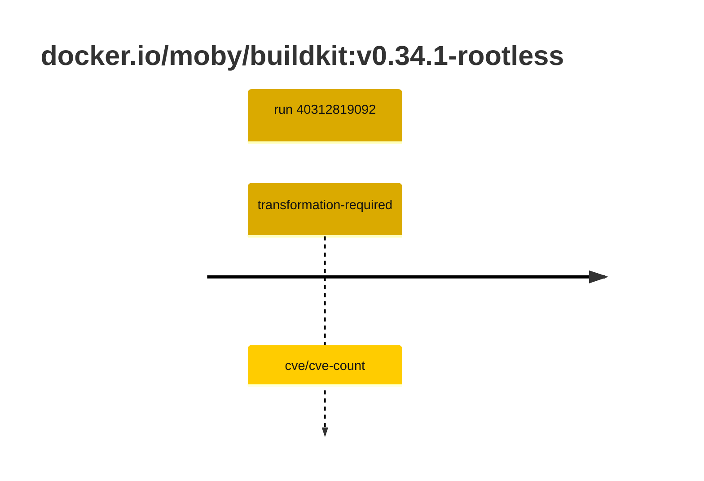

## buildkit-0 · docker.io/moby/buildkit:v0.34.1-rootless

`sha256:f68752a5a94acfcdad2d07867b7075601a421638e17fc5f28efc1c814d0c4f89`

| ts | run | state | reason | ruleset | report | details |
| --- | --- | --- | --- | --- | --- | --- |
| 2026-10-26T11:23:25Z | [40312819092](https://github.com/trivoallan/base-images/actions/runs/40312819092) | transformation-required | cve/cve-count | sha256:7d034c36a6153b33b76e2b2f7b4d84678e9d65039092cf8c67467d573f20ba84 | `results/reports/buildkit-0/sha256:f68752a5a94acfcdad2d07867b7075601a421638e17fc5f28efc1c814d0c4f89/40312819092-1.md` | repairable: true |

---

<!-- regis -->
# docker.io/moby/buildkit:sha256:f68752a5a94acfcdad2d07867b7075601a421638e17fc5f28efc1c814d0c4f89

## 🏷️ Transformation requise puis placement · 57/100

**4/7 rules · 3 failed · worst: 🟥 critical**

| | Rule | Level | Result |
| --- | --- | --- | --- |
| ✗ | cve-critical | critical | Image has 21 critical CVEs (max allowed: 0). |
| ✗ | cve-fixable | warning | Image has 432 vulnerabilities with available fixes. |
| ✗ | cve-high | warning | Image has 256 high CVEs (max allowed: 10). |

**Analysis date:** 2026-10-26T11:23:24.195236+00:00

## Playbook results

| Playbook | Verdict | Failing rules |
| --- | --- | --- |
| Image reconstructible | 🏷️ Transformation requise puis placement · 57/100 | 3 |
