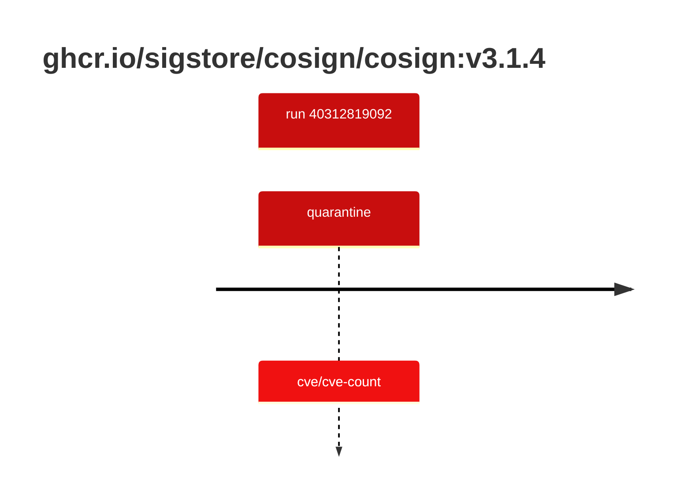

## cosign-3 · ghcr.io/sigstore/cosign/cosign:v3.1.4

`sha256:0f06154836d2de34f887a5c273506d52ca43edaa1d9e53e6510fa78a48f69c2d`

| ts | run | state | reason | ruleset | report | details |
| --- | --- | --- | --- | --- | --- | --- |
| 2026-10-26T11:11:58Z | [40312819092](https://github.com/trivoallan/base-images/actions/runs/40312819092) | quarantine | cve/cve-count | sha256:0936ffb81cdaa3596af399bfa54a5c6b9171416996ea31b39bc77dab6a8c1585 | `results/reports/cosign-3/sha256:0f06154836d2de34f887a5c273506d52ca43edaa1d9e53e6510fa78a48f69c2d/40312819092-1.md` |  |

---

<!-- regis -->
# ghcr.io/sigstore/cosign/cosign:sha256:0f06154836d2de34f887a5c273506d52ca43edaa1d9e53e6510fa78a48f69c2d

## 🏷️ Quarantaine · 67/100

**4/6 rules · 2 failed · worst: 🟥 critical**

| | Rule | Level | Result |
| --- | --- | --- | --- |
| ✗ | cve-critical | critical | Image has 3 critical CVEs (max allowed: 0). |
| ✗ | cve-high | warning | Image has 20 high CVEs (max allowed: 10). |

**Analysis date:** 2026-10-26T11:11:55.108943+00:00

## Playbook results

| Playbook | Verdict | Failing rules |
| --- | --- | --- |
| Image copiée | 🏷️ Quarantaine · 67/100 | 2 |
