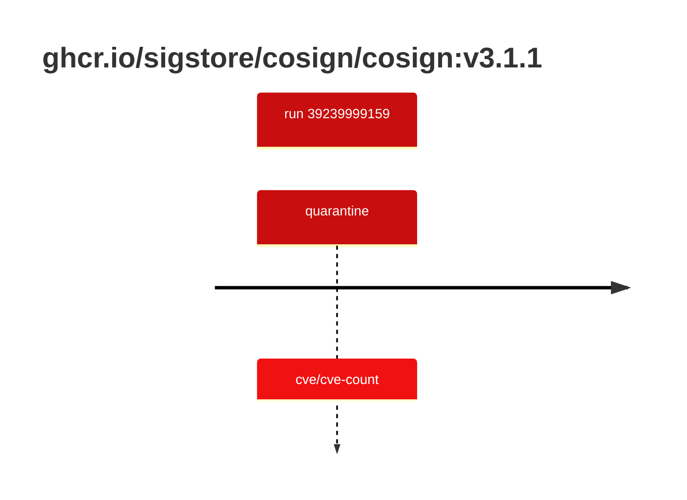

## cosign-3 · ghcr.io/sigstore/cosign/cosign:v3.1.1

`sha256:6bbe0d281d955c79f85b325f0f7e651c1bcab5a4fa4ad4903d74955178a3b2eb`

| ts | run | state | reason | ruleset | report | details |
| --- | --- | --- | --- | --- | --- | --- |
| 2026-10-19T10:50:18Z | [39239999159](https://github.com/trivoallan/base-images/actions/runs/39239999159) | quarantine | cve/cve-count | sha256:0936ffb81cdaa3596af399bfa54a5c6b9171416996ea31b39bc77dab6a8c1585 | `results/reports/cosign-3/sha256:6bbe0d281d955c79f85b325f0f7e651c1bcab5a4fa4ad4903d74955178a3b2eb/39239999159-1.md` |  |

---

<!-- regis -->
# ghcr.io/sigstore/cosign/cosign:sha256:6bbe0d281d955c79f85b325f0f7e651c1bcab5a4fa4ad4903d74955178a3b2eb

## 🏷️ Quarantaine · 67/100

**4/6 rules · 2 failed · worst: 🟥 critical**

| | Rule | Level | Result |
| --- | --- | --- | --- |
| ✗ | cve-critical | critical | Image has 4 critical CVEs (max allowed: 0). |
| ✗ | cve-high | warning | Image has 54 high CVEs (max allowed: 10). |

**Analysis date:** 2026-10-19T10:50:11.427528+00:00

## Playbook results

| Playbook | Verdict | Failing rules |
| --- | --- | --- |
| Image copiée | 🏷️ Quarantaine · 67/100 | 2 |
