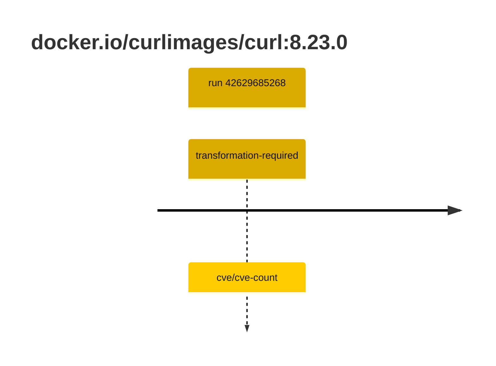

## curl-8 · docker.io/curlimages/curl:8.23.0

`sha256:3fb7e13e5d179a845c97d78204f3f1064d1907037f26a3ebf91710571151fd93`

| ts | run | state | reason | ruleset | report | details |
| --- | --- | --- | --- | --- | --- | --- |
| 2026-11-09T14:08:02Z | [42629685268](https://github.com/trivoallan/base-images/actions/runs/42629685268) | transformation-required | cve/cve-count | sha256:7d034c36a6153b33b76e2b2f7b4d84678e9d65039092cf8c67467d573f20ba84 | `results/reports/curl-8/sha256:3fb7e13e5d179a845c97d78204f3f1064d1907037f26a3ebf91710571151fd93/42629685268-1.md` | repairable: true |

---

<!-- regis -->
# docker.io/curlimages/curl:sha256:3fb7e13e5d179a845c97d78204f3f1064d1907037f26a3ebf91710571151fd93

## 🏷️ Transformation requise puis placement · 71/100

**5/7 rules · 2 failed · worst: 🟥 critical**

| | Rule | Level | Result |
| --- | --- | --- | --- |
| ✗ | cve-critical | critical | Image has 1 critical CVEs (max allowed: 0). |
| ✗ | cve-fixable | warning | Image has 1 vulnerabilities with available fixes. |

**Analysis date:** 2026-11-09T14:08:01.834899+00:00

## Playbook results

| Playbook | Verdict | Failing rules |
| --- | --- | --- |
| Image reconstructible | 🏷️ Transformation requise puis placement · 71/100 | 2 |
