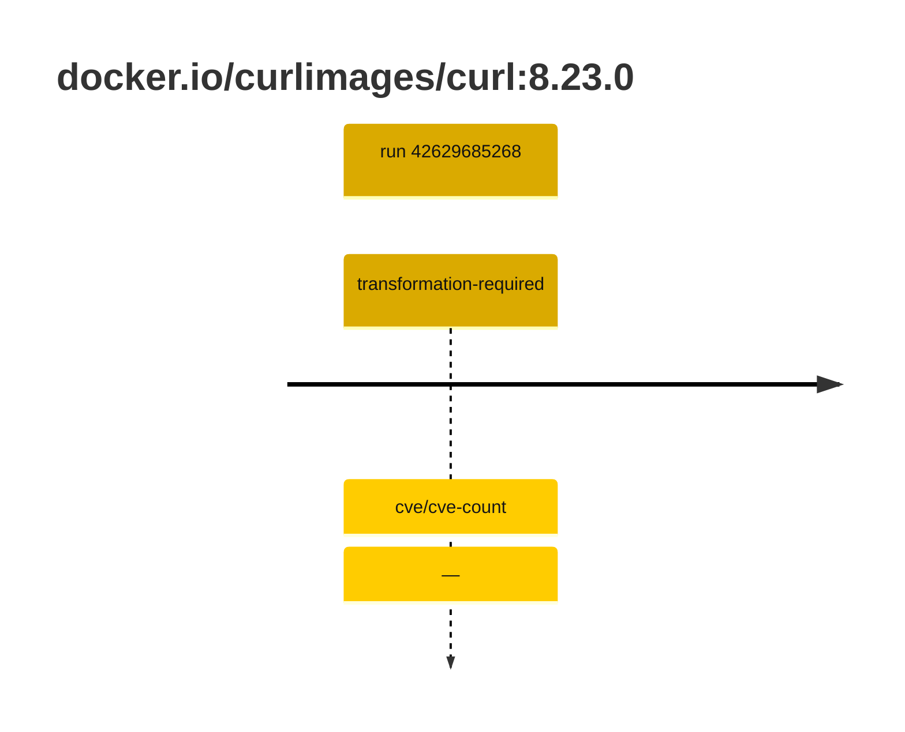
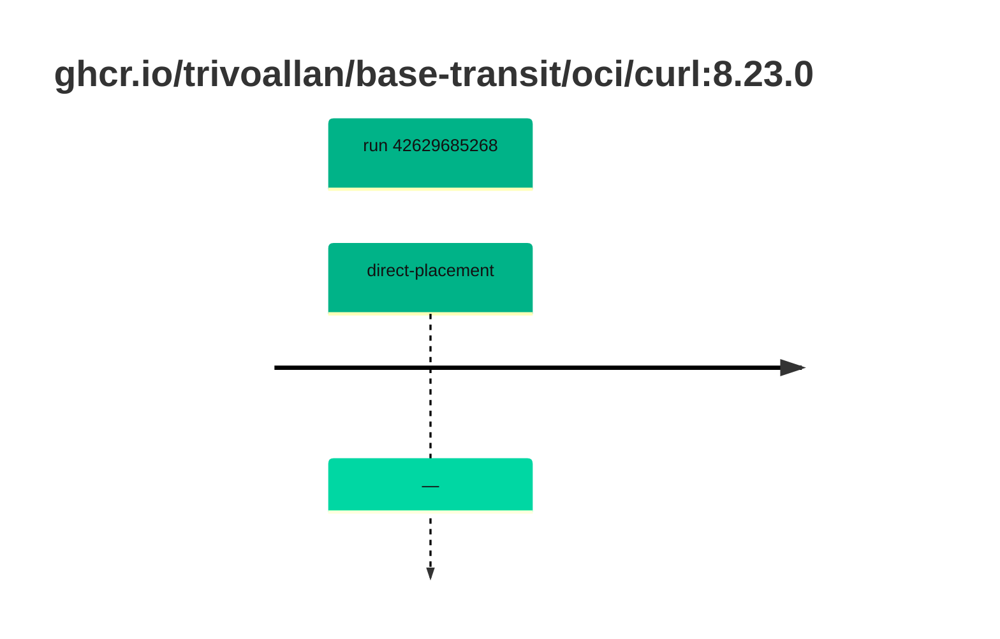

## curl-8 · docker.io/curlimages/curl:8.23.0

`sha256:3fb7e13e5d179a845c97d78204f3f1064d1907037f26a3ebf91710571151fd93`

| ts | run | state | reason | ruleset | report | details |
| --- | --- | --- | --- | --- | --- | --- |
| 2026-11-09T14:08:02Z | [42629685268](https://github.com/trivoallan/base-images/actions/runs/42629685268) | transformation-required | cve/cve-count | sha256:7d034c36a6153b33b76e2b2f7b4d84678e9d65039092cf8c67467d573f20ba84 | `results/reports/curl-8/sha256:3fb7e13e5d179a845c97d78204f3f1064d1907037f26a3ebf91710571151fd93/42629685268-1.md` | repairable: true |
| 2026-11-09T14:10:09Z | [42629685268](https://github.com/trivoallan/base-images/actions/runs/42629685268) | transformation-required | — | sha256:7d034c36a6153b33b76e2b2f7b4d84678e9d65039092cf8c67467d573f20ba84 |  | placed: sha256:560c8eb13acc7d6f9b51b26866dbde782da315e157de5882b88f9e77ff8b3565 |

## curl-8 · ghcr.io/trivoallan/base-transit/oci/curl:8.23.0

`sha256:560c8eb13acc7d6f9b51b26866dbde782da315e157de5882b88f9e77ff8b3565`

| ts | run | state | reason | ruleset | report | details |
| --- | --- | --- | --- | --- | --- | --- |
| 2026-11-09T14:09:31Z | [42629685268](https://github.com/trivoallan/base-images/actions/runs/42629685268) | direct-placement | — | sha256:7d034c36a6153b33b76e2b2f7b4d84678e9d65039092cf8c67467d573f20ba84 | `results/reports/curl-8/sha256:560c8eb13acc7d6f9b51b26866dbde782da315e157de5882b88f9e77ff8b3565/42629685268-1.md` | source: sha256:3fb7e13e5d179a845c97d78204f3f1064d1907037f26a3ebf91710571151fd93; epoch: 20261109T135548Z |

---

<!-- regis -->
# ghcr.io/trivoallan/base-transit/oci/curl:sha256:560c8eb13acc7d6f9b51b26866dbde782da315e157de5882b88f9e77ff8b3565

## 🏷️ Placement direct · 100/100

**7/7 rules · all pass ✓**

**Analysis date:** 2026-11-09T14:09:30.731676+00:00

## Playbook results

| Playbook | Verdict | Failing rules |
| --- | --- | --- |
| Image reconstructible | 🏷️ Placement direct · 100/100 | 0 |
