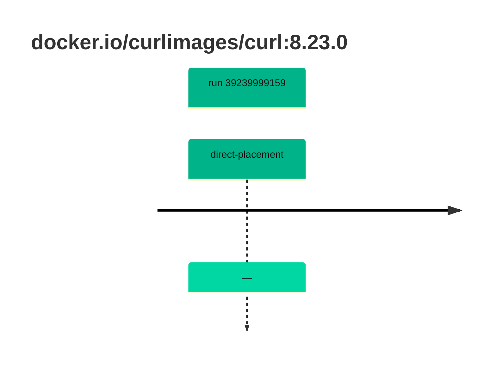

## curl-8 · docker.io/curlimages/curl:8.23.0

`sha256:a134550be58ab783810e613ae96fd253c38f7bdd16d9bf9be350700c7a29ac06`

| ts | run | state | reason | ruleset | report | details |
| --- | --- | --- | --- | --- | --- | --- |
| 2026-10-19T11:11:42Z | [39239999159](https://github.com/trivoallan/base-images/actions/runs/39239999159) | direct-placement | — | sha256:7d034c36a6153b33b76e2b2f7b4d84678e9d65039092cf8c67467d573f20ba84 | `results/reports/curl-8/sha256:a134550be58ab783810e613ae96fd253c38f7bdd16d9bf9be350700c7a29ac06/39239999159-1.md` |  |

---

<!-- regis -->
# docker.io/curlimages/curl:sha256:a134550be58ab783810e613ae96fd253c38f7bdd16d9bf9be350700c7a29ac06

## 🏷️ Placement direct · 100/100

**7/7 rules · all pass ✓**

**Analysis date:** 2026-10-19T11:11:41.637571+00:00

## Playbook results

| Playbook | Verdict | Failing rules |
| --- | --- | --- |
| Image reconstructible | 🏷️ Placement direct · 100/100 | 0 |
