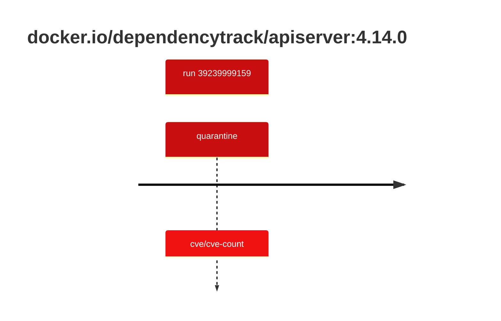

## dependencytrack-apiserver-4 · docker.io/dependencytrack/apiserver:4.14.0

`sha256:13ef5f62b41e3c6a2a3bf401b7bb8d34da15b28c29cde425a2ccbf13643e026c`

| ts | run | state | reason | ruleset | report | details |
| --- | --- | --- | --- | --- | --- | --- |
| 2026-10-19T10:51:56Z | [39239999159](https://github.com/trivoallan/base-images/actions/runs/39239999159) | quarantine | cve/cve-count | sha256:0936ffb81cdaa3596af399bfa54a5c6b9171416996ea31b39bc77dab6a8c1585 | `results/reports/dependencytrack-apiserver-4/sha256:13ef5f62b41e3c6a2a3bf401b7bb8d34da15b28c29cde425a2ccbf13643e026c/39239999159-1.md` |  |

---

<!-- regis -->
# docker.io/dependencytrack/apiserver:sha256:13ef5f62b41e3c6a2a3bf401b7bb8d34da15b28c29cde425a2ccbf13643e026c

## 🏷️ Quarantaine · 50/100

**3/6 rules · 3 failed · worst: 🟥 critical**

| | Rule | Level | Result |
| --- | --- | --- | --- |
| ✗ | cve-critical | critical | Image has 34 critical CVEs (max allowed: 0). |
| ✗ | cve-high | warning | Image has 254 high CVEs (max allowed: 10). |
| ✗ | freshness | warning | Image is older than 90 days (223 days). |

**Analysis date:** 2026-10-19T10:51:55.445721+00:00

## Playbook results

| Playbook | Verdict | Failing rules |
| --- | --- | --- |
| Image copiée | 🏷️ Quarantaine · 50/100 | 3 |
