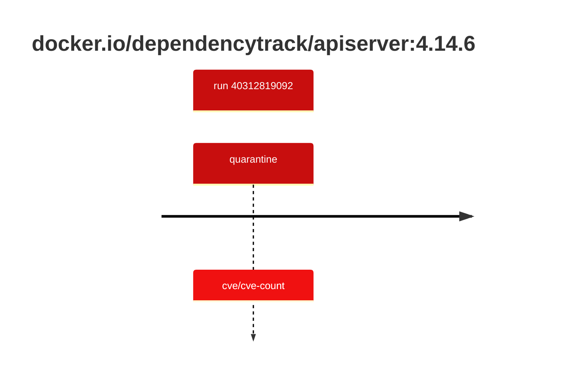

## dependencytrack-apiserver-4 · docker.io/dependencytrack/apiserver:4.14.6

`sha256:3110dd66ee9d1b4b9a4dc6c51c68c23f14ba006b6e5a74d0b5204e169a1da09a`

| ts | run | state | reason | ruleset | report | details |
| --- | --- | --- | --- | --- | --- | --- |
| 2026-10-26T11:12:49Z | [40312819092](https://github.com/trivoallan/base-images/actions/runs/40312819092) | quarantine | cve/cve-count | sha256:0936ffb81cdaa3596af399bfa54a5c6b9171416996ea31b39bc77dab6a8c1585 | `results/reports/dependencytrack-apiserver-4/sha256:3110dd66ee9d1b4b9a4dc6c51c68c23f14ba006b6e5a74d0b5204e169a1da09a/40312819092-1.md` |  |

---

<!-- regis -->
# docker.io/dependencytrack/apiserver:sha256:3110dd66ee9d1b4b9a4dc6c51c68c23f14ba006b6e5a74d0b5204e169a1da09a

## 🏷️ Quarantaine · 67/100

**4/6 rules · 2 failed · worst: 🟥 critical**

| | Rule | Level | Result |
| --- | --- | --- | --- |
| ✗ | cve-critical | critical | Image has 12 critical CVEs (max allowed: 0). |
| ✗ | cve-high | warning | Image has 90 high CVEs (max allowed: 10). |

**Analysis date:** 2026-10-26T11:12:48.666018+00:00

## Playbook results

| Playbook | Verdict | Failing rules |
| --- | --- | --- |
| Image copiée | 🏷️ Quarantaine · 67/100 | 2 |
