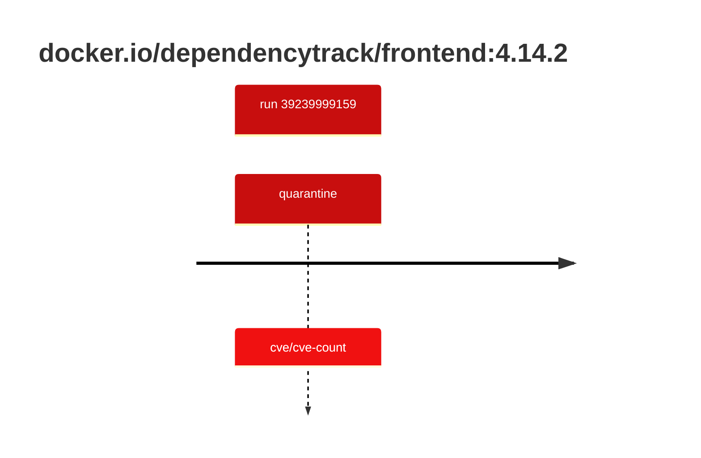

## dependencytrack-frontend-4 · docker.io/dependencytrack/frontend:4.14.2

`sha256:00560b57a6cfdec3c02a6e02be80fce97029241a9c653e8b83c0b670dff1f3ca`

| ts | run | state | reason | ruleset | report | details |
| --- | --- | --- | --- | --- | --- | --- |
| 2026-10-19T10:54:08Z | [39239999159](https://github.com/trivoallan/base-images/actions/runs/39239999159) | quarantine | cve/cve-count | sha256:0936ffb81cdaa3596af399bfa54a5c6b9171416996ea31b39bc77dab6a8c1585 | `results/reports/dependencytrack-frontend-4/sha256:00560b57a6cfdec3c02a6e02be80fce97029241a9c653e8b83c0b670dff1f3ca/39239999159-1.md` |  |

---

<!-- regis -->
# docker.io/dependencytrack/frontend:sha256:00560b57a6cfdec3c02a6e02be80fce97029241a9c653e8b83c0b670dff1f3ca

## 🏷️ Quarantaine · 50/100

**3/6 rules · 3 failed · worst: 🟥 critical**

| | Rule | Level | Result |
| --- | --- | --- | --- |
| ✗ | cve-critical | critical | Image has 26 critical CVEs (max allowed: 0). |
| ✗ | cve-high | warning | Image has 105 high CVEs (max allowed: 10). |
| ✗ | freshness | warning | Image is older than 90 days (164 days). |

**Analysis date:** 2026-10-19T10:54:07.917301+00:00

## Playbook results

| Playbook | Verdict | Failing rules |
| --- | --- | --- |
| Image copiée | 🏷️ Quarantaine · 50/100 | 3 |
