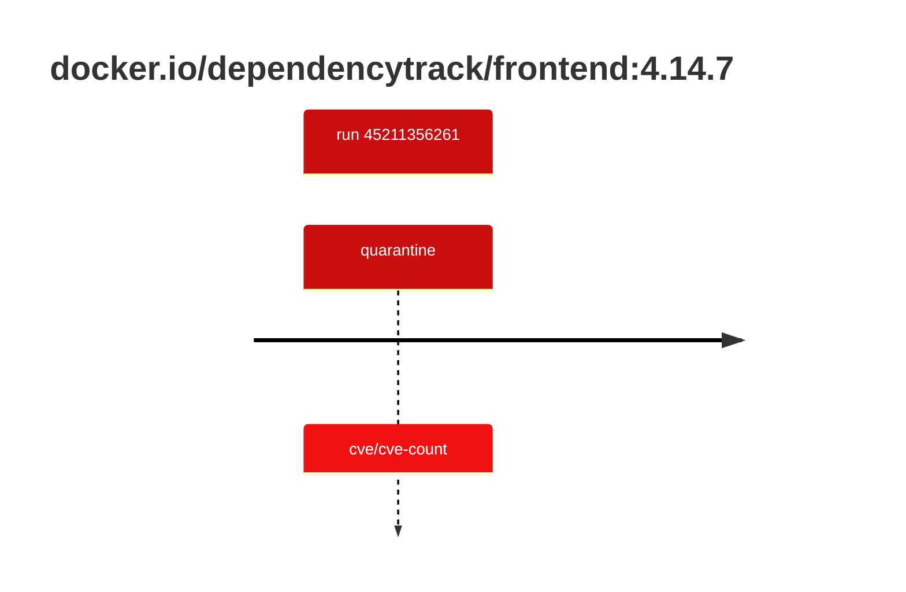

## dependencytrack-frontend-4 · docker.io/dependencytrack/frontend:4.14.7

`sha256:3ca8ca16bce633525a12b535803cc046a0870dfb6ea0c78904e9b130534bf696`

| ts | run | state | reason | ruleset | report | details |
| --- | --- | --- | --- | --- | --- | --- |
| 2026-11-23T16:05:20Z | [45211356261](https://github.com/trivoallan/base-images/actions/runs/45211356261) | quarantine | cve/cve-count | sha256:0936ffb81cdaa3596af399bfa54a5c6b9171416996ea31b39bc77dab6a8c1585 | `results/reports/dependencytrack-frontend-4/sha256:3ca8ca16bce633525a12b535803cc046a0870dfb6ea0c78904e9b130534bf696/45211356261-1.md` |  |

---

<!-- regis -->
# docker.io/dependencytrack/frontend:sha256:3ca8ca16bce633525a12b535803cc046a0870dfb6ea0c78904e9b130534bf696

## 🏷️ Quarantaine · 67/100

**4/6 rules · 2 failed · worst: 🟥 critical**

| | Rule | Level | Result |
| --- | --- | --- | --- |
| ✗ | cve-critical | critical | Image has 1 critical CVEs (max allowed: 0). |
| ✗ | cve-high | warning | Image has 18 high CVEs (max allowed: 10). |

**Analysis date:** 2026-11-23T16:05:19.979675+00:00

## Playbook results

| Playbook | Verdict | Failing rules |
| --- | --- | --- |
| Image copiée | 🏷️ Quarantaine · 67/100 | 2 |
