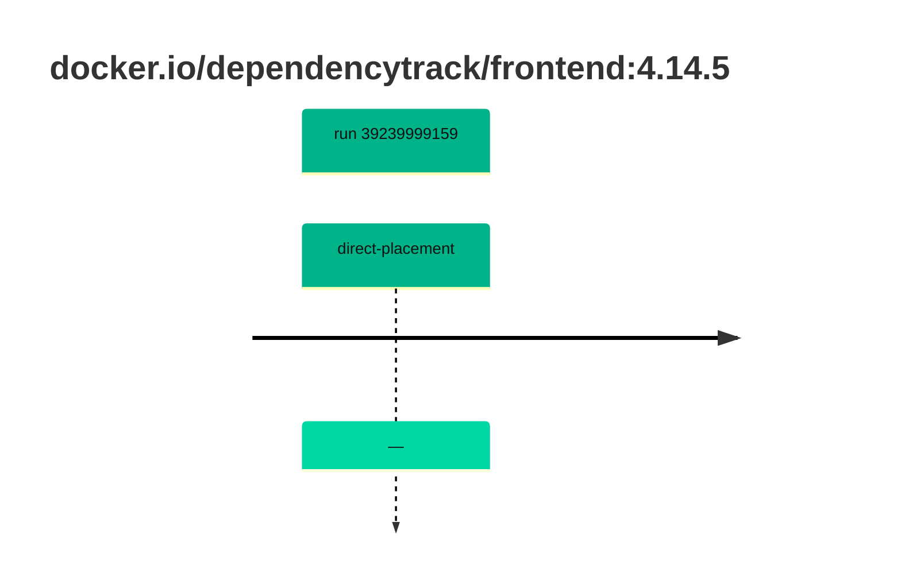

## dependencytrack-frontend-4 · docker.io/dependencytrack/frontend:4.14.5

`sha256:d675efbd80facddb696c21c82e1973d0dc83ae38b3c896d1c87bf78a26a6c9eb`

| ts | run | state | reason | ruleset | report | details |
| --- | --- | --- | --- | --- | --- | --- |
| 2026-10-19T10:54:43Z | [39239999159](https://github.com/trivoallan/base-images/actions/runs/39239999159) | direct-placement | — | sha256:0936ffb81cdaa3596af399bfa54a5c6b9171416996ea31b39bc77dab6a8c1585 | `results/reports/dependencytrack-frontend-4/sha256:d675efbd80facddb696c21c82e1973d0dc83ae38b3c896d1c87bf78a26a6c9eb/39239999159-1.md` |  |

---

<!-- regis -->
# docker.io/dependencytrack/frontend:sha256:d675efbd80facddb696c21c82e1973d0dc83ae38b3c896d1c87bf78a26a6c9eb

## 🏷️ Placement direct · 83/100

**5/6 rules · 1 failed · worst: 🟧 warning**

| | Rule | Level | Result |
| --- | --- | --- | --- |
| ✗ | cve-high | warning | Image has 14 high CVEs (max allowed: 10). |

**Analysis date:** 2026-10-19T10:54:42.738016+00:00

## Playbook results

| Playbook | Verdict | Failing rules |
| --- | --- | --- |
| Image copiée | 🏷️ Placement direct · 83/100 | 1 |
