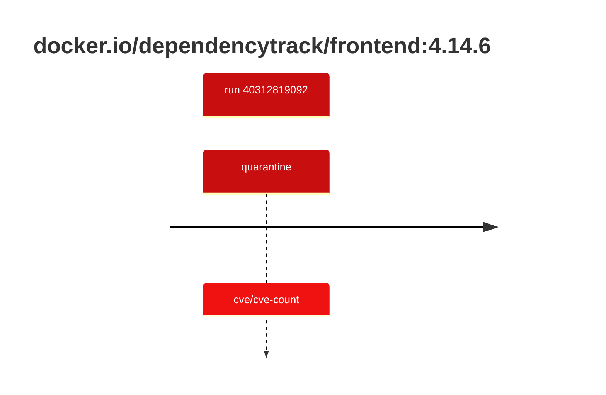

## dependencytrack-frontend-4 · docker.io/dependencytrack/frontend:4.14.6

`sha256:f298c3e6061096bf76575a1bbe994528089141856ec7b2ec63469cf3f2abeedf`

| ts | run | state | reason | ruleset | report | details |
| --- | --- | --- | --- | --- | --- | --- |
| 2026-10-26T11:13:36Z | [40312819092](https://github.com/trivoallan/base-images/actions/runs/40312819092) | quarantine | cve/cve-count | sha256:0936ffb81cdaa3596af399bfa54a5c6b9171416996ea31b39bc77dab6a8c1585 | `results/reports/dependencytrack-frontend-4/sha256:f298c3e6061096bf76575a1bbe994528089141856ec7b2ec63469cf3f2abeedf/40312819092-1.md` |  |

---

<!-- regis -->
# docker.io/dependencytrack/frontend:sha256:f298c3e6061096bf76575a1bbe994528089141856ec7b2ec63469cf3f2abeedf

## 🏷️ Quarantaine · 83/100

**5/6 rules · 1 failed · worst: 🟥 critical**

| | Rule | Level | Result |
| --- | --- | --- | --- |
| ✗ | cve-critical | critical | Image has 1 critical CVEs (max allowed: 0). |

**Analysis date:** 2026-10-26T11:13:35.731932+00:00

## Playbook results

| Playbook | Verdict | Failing rules |
| --- | --- | --- |
| Image copiée | 🏷️ Quarantaine · 83/100 | 1 |
