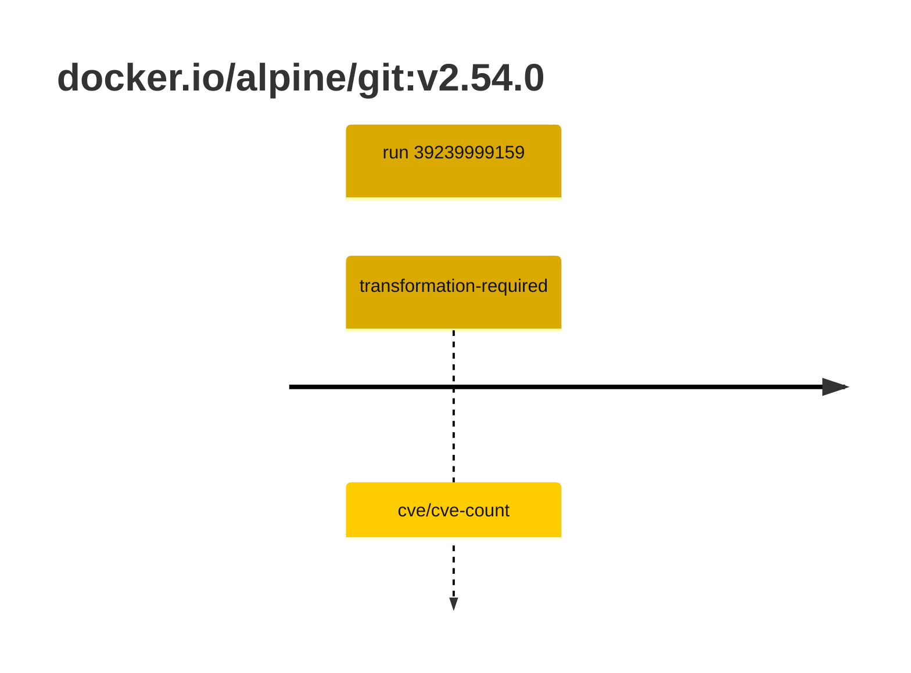

## git-2 · docker.io/alpine/git:v2.54.0

`sha256:03228d7ded483b0b3e55e1de7fa660d70d3e1bb432fa7021d29e192640de11aa`

| ts | run | state | reason | ruleset | report | details |
| --- | --- | --- | --- | --- | --- | --- |
| 2026-10-19T11:13:01Z | [39239999159](https://github.com/trivoallan/base-images/actions/runs/39239999159) | transformation-required | cve/cve-count | sha256:7d034c36a6153b33b76e2b2f7b4d84678e9d65039092cf8c67467d573f20ba84 | `results/reports/git-2/sha256:03228d7ded483b0b3e55e1de7fa660d70d3e1bb432fa7021d29e192640de11aa/39239999159-1.md` | repairable: true |

---

<!-- regis -->
# docker.io/alpine/git:sha256:03228d7ded483b0b3e55e1de7fa660d70d3e1bb432fa7021d29e192640de11aa

## 🏷️ Transformation requise puis placement · 57/100

**4/7 rules · 3 failed · worst: 🟥 critical**

| | Rule | Level | Result |
| --- | --- | --- | --- |
| ✗ | cve-critical | critical | Image has 5 critical CVEs (max allowed: 0). |
| ✗ | cve-fixable | warning | Image has 37 vulnerabilities with available fixes. |
| ✗ | cve-high | warning | Image has 36 high CVEs (max allowed: 10). |

**Analysis date:** 2026-10-19T11:13:00.651265+00:00

## Playbook results

| Playbook | Verdict | Failing rules |
| --- | --- | --- |
| Image reconstructible | 🏷️ Transformation requise puis placement · 57/100 | 3 |
