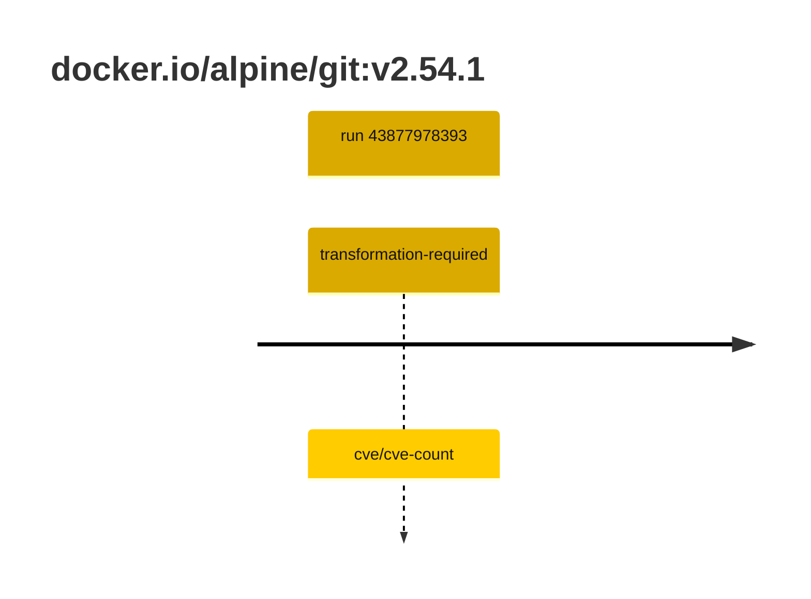

## git-2 · docker.io/alpine/git:v2.54.1

`sha256:2306e2b05ee0ef99f5d25b0779f645b24ae9f91ba187107503592fcdfe78da3a`

| ts | run | state | reason | ruleset | report | details |
| --- | --- | --- | --- | --- | --- | --- |
| 2026-11-16T13:49:44Z | [43877978393](https://github.com/trivoallan/base-images/actions/runs/43877978393) | transformation-required | cve/cve-count | sha256:7d034c36a6153b33b76e2b2f7b4d84678e9d65039092cf8c67467d573f20ba84 | `results/reports/git-2/sha256:2306e2b05ee0ef99f5d25b0779f645b24ae9f91ba187107503592fcdfe78da3a/43877978393-1.md` | repairable: true |

---

<!-- regis -->
# docker.io/alpine/git:sha256:2306e2b05ee0ef99f5d25b0779f645b24ae9f91ba187107503592fcdfe78da3a

## 🏷️ Transformation requise puis placement · 71/100

**5/7 rules · 2 failed · worst: 🟥 critical**

| | Rule | Level | Result |
| --- | --- | --- | --- |
| ✗ | cve-critical | critical | Image has 1 critical CVEs (max allowed: 0). |
| ✗ | cve-fixable | warning | Image has 7 vulnerabilities with available fixes. |

**Analysis date:** 2026-11-16T13:49:43.776547+00:00

## Playbook results

| Playbook | Verdict | Failing rules |
| --- | --- | --- |
| Image reconstructible | 🏷️ Transformation requise puis placement · 71/100 | 2 |
