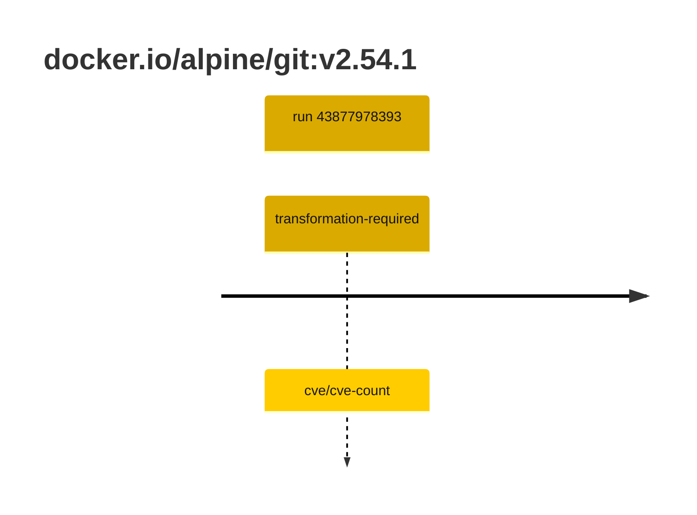
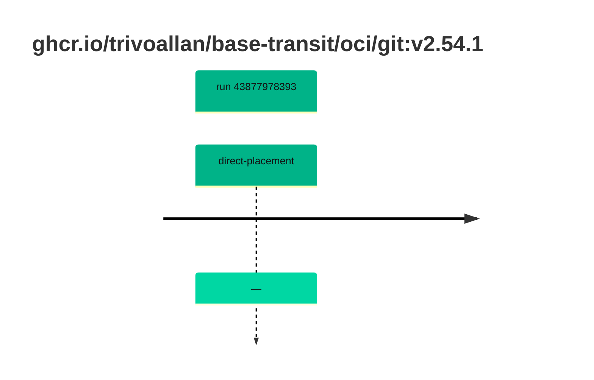

## git-2 · docker.io/alpine/git:v2.54.1

`sha256:2306e2b05ee0ef99f5d25b0779f645b24ae9f91ba187107503592fcdfe78da3a`

| ts | run | state | reason | ruleset | report | details |
| --- | --- | --- | --- | --- | --- | --- |
| 2026-11-16T13:49:44Z | [43877978393](https://github.com/trivoallan/base-images/actions/runs/43877978393) | transformation-required | cve/cve-count | sha256:7d034c36a6153b33b76e2b2f7b4d84678e9d65039092cf8c67467d573f20ba84 | `results/reports/git-2/sha256:2306e2b05ee0ef99f5d25b0779f645b24ae9f91ba187107503592fcdfe78da3a/43877978393-1.md` | repairable: true |

## git-2 · ghcr.io/trivoallan/base-transit/oci/git:v2.54.1

`sha256:5c71a830f993831413d279af322aa2c8031e7220f874fbce105853abea9302ab`

| ts | run | state | reason | ruleset | report | details |
| --- | --- | --- | --- | --- | --- | --- |
| 2026-11-16T13:51:16Z | [43877978393](https://github.com/trivoallan/base-images/actions/runs/43877978393) | direct-placement | — | sha256:7d034c36a6153b33b76e2b2f7b4d84678e9d65039092cf8c67467d573f20ba84 | `results/reports/git-2/sha256:5c71a830f993831413d279af322aa2c8031e7220f874fbce105853abea9302ab/43877978393-1.md` | source: sha256:2306e2b05ee0ef99f5d25b0779f645b24ae9f91ba187107503592fcdfe78da3a; epoch: 20261116T134038Z |

---

<!-- regis -->
# ghcr.io/trivoallan/base-transit/oci/git:sha256:5c71a830f993831413d279af322aa2c8031e7220f874fbce105853abea9302ab

## 🏷️ Placement direct · 86/100

**6/7 rules · 1 failed · worst: 🟧 warning**

| | Rule | Level | Result |
| --- | --- | --- | --- |
| ✗ | cve-fixable | warning | Image has 6 vulnerabilities with available fixes. |

**Analysis date:** 2026-11-16T13:51:15.892453+00:00

## Playbook results

| Playbook | Verdict | Failing rules |
| --- | --- | --- |
| Image reconstructible | 🏷️ Placement direct · 86/100 | 1 |
