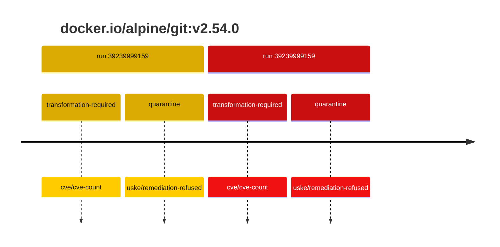
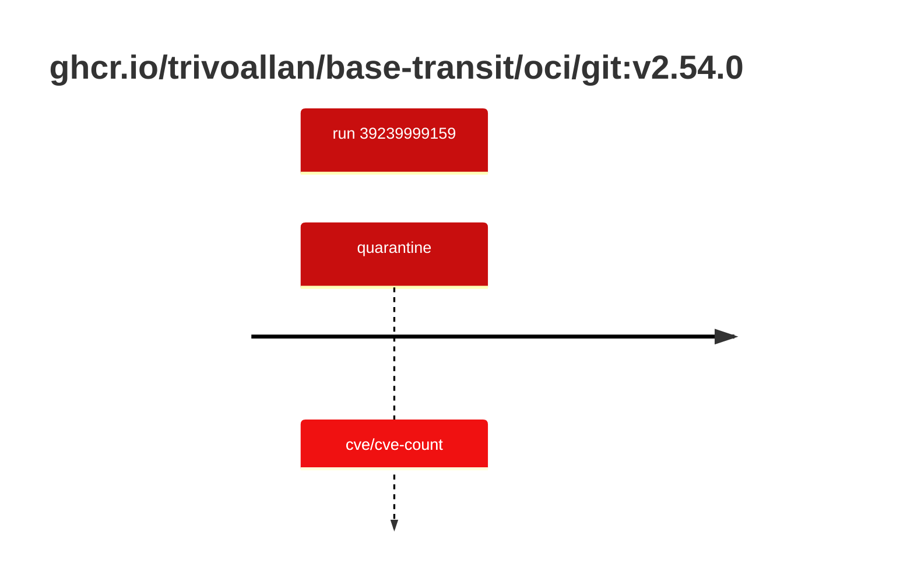

## git-2 · docker.io/alpine/git:v2.54.0

`sha256:03228d7ded483b0b3e55e1de7fa660d70d3e1bb432fa7021d29e192640de11aa`

| ts | run | state | reason | ruleset | report | details |
| --- | --- | --- | --- | --- | --- | --- |
| 2026-10-19T11:13:01Z | [39239999159](https://github.com/trivoallan/base-images/actions/runs/39239999159) | transformation-required | cve/cve-count | sha256:7d034c36a6153b33b76e2b2f7b4d84678e9d65039092cf8c67467d573f20ba84 | `results/reports/git-2/sha256:03228d7ded483b0b3e55e1de7fa660d70d3e1bb432fa7021d29e192640de11aa/39239999159-1.md` | repairable: true |
| 2026-10-19T11:14:21Z | [39239999159](https://github.com/trivoallan/base-images/actions/runs/39239999159) | quarantine | uske/remediation-refused | sha256:7d034c36a6153b33b76e2b2f7b4d84678e9d65039092cf8c67467d573f20ba84 | `results/reports/git-2/sha256:8c6f2cb84149c38f99af16817fec6c697455889a908c73decfc6b609a2ca17e6/39239999159-1.md` | rebuilt: sha256:8c6f2cb84149c38f99af16817fec6c697455889a908c73decfc6b609a2ca17e6 |

## git-2 · ghcr.io/trivoallan/base-transit/oci/git:v2.54.0

`sha256:8c6f2cb84149c38f99af16817fec6c697455889a908c73decfc6b609a2ca17e6`

| ts | run | state | reason | ruleset | report | details |
| --- | --- | --- | --- | --- | --- | --- |
| 2026-10-19T11:14:21Z | [39239999159](https://github.com/trivoallan/base-images/actions/runs/39239999159) | quarantine | cve/cve-count | sha256:7d034c36a6153b33b76e2b2f7b4d84678e9d65039092cf8c67467d573f20ba84 | `results/reports/git-2/sha256:8c6f2cb84149c38f99af16817fec6c697455889a908c73decfc6b609a2ca17e6/39239999159-1.md` | source: sha256:03228d7ded483b0b3e55e1de7fa660d70d3e1bb432fa7021d29e192640de11aa; epoch: 20261019T104819Z |

---

<!-- regis -->
# ghcr.io/trivoallan/base-transit/oci/git:sha256:8c6f2cb84149c38f99af16817fec6c697455889a908c73decfc6b609a2ca17e6

## 🏷️ Quarantaine · 86/100

**6/7 rules · 1 failed · worst: 🟥 critical**

| | Rule | Level | Result |
| --- | --- | --- | --- |
| ✗ | cve-critical | critical | Image has 1 critical CVEs (max allowed: 0). |

**Analysis date:** 2026-10-19T11:14:20.760194+00:00

## Playbook results

| Playbook | Verdict | Failing rules |
| --- | --- | --- |
| Image reconstructible | 🏷️ Quarantaine · 86/100 | 1 |
