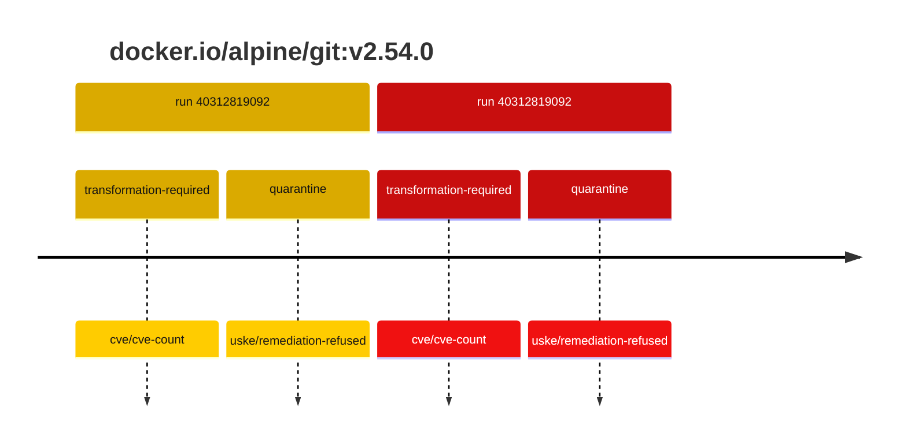
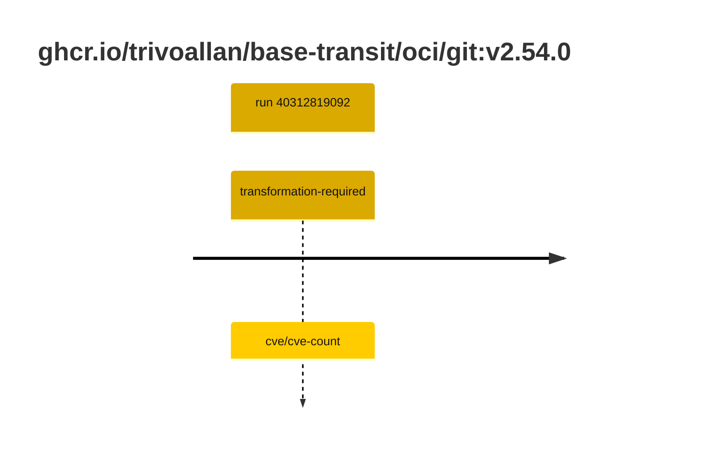

## git-2 · docker.io/alpine/git:v2.54.0

`sha256:e8ceedc73bd80992ae8d58a7d24c58b8322146c354f1d2e81a97db4452068ec0`

| ts | run | state | reason | ruleset | report | details |
| --- | --- | --- | --- | --- | --- | --- |
| 2026-10-26T11:26:05Z | [40312819092](https://github.com/trivoallan/base-images/actions/runs/40312819092) | transformation-required | cve/cve-count | sha256:7d034c36a6153b33b76e2b2f7b4d84678e9d65039092cf8c67467d573f20ba84 | `results/reports/git-2/sha256:e8ceedc73bd80992ae8d58a7d24c58b8322146c354f1d2e81a97db4452068ec0/40312819092-1.md` | repairable: true |
| 2026-10-26T11:27:39Z | [40312819092](https://github.com/trivoallan/base-images/actions/runs/40312819092) | quarantine | uske/remediation-refused | sha256:7d034c36a6153b33b76e2b2f7b4d84678e9d65039092cf8c67467d573f20ba84 | `results/reports/git-2/sha256:e4cc11a64dddc6c85a8d614b20d8a844efb53576f021f6c5cfffc13b9ddf1665/40312819092-1.md` | rebuilt: sha256:e4cc11a64dddc6c85a8d614b20d8a844efb53576f021f6c5cfffc13b9ddf1665 |

## git-2 · ghcr.io/trivoallan/base-transit/oci/git:v2.54.0

`sha256:e4cc11a64dddc6c85a8d614b20d8a844efb53576f021f6c5cfffc13b9ddf1665`

| ts | run | state | reason | ruleset | report | details |
| --- | --- | --- | --- | --- | --- | --- |
| 2026-10-26T11:27:39Z | [40312819092](https://github.com/trivoallan/base-images/actions/runs/40312819092) | transformation-required | cve/cve-count | sha256:7d034c36a6153b33b76e2b2f7b4d84678e9d65039092cf8c67467d573f20ba84 | `results/reports/git-2/sha256:e4cc11a64dddc6c85a8d614b20d8a844efb53576f021f6c5cfffc13b9ddf1665/40312819092-1.md` | source: sha256:e8ceedc73bd80992ae8d58a7d24c58b8322146c354f1d2e81a97db4452068ec0; epoch: 20261026T110911Z |

---

<!-- regis -->
# docker.io/alpine/git:sha256:e8ceedc73bd80992ae8d58a7d24c58b8322146c354f1d2e81a97db4452068ec0

## 🏷️ Transformation requise puis placement · 71/100

**5/7 rules · 2 failed · worst: 🟥 critical**

| | Rule | Level | Result |
| --- | --- | --- | --- |
| ✗ | cve-critical | critical | Image has 1 critical CVEs (max allowed: 0). |
| ✗ | cve-fixable | warning | Image has 25 vulnerabilities with available fixes. |

**Analysis date:** 2026-10-26T11:26:05.163756+00:00

## Playbook results

| Playbook | Verdict | Failing rules |
| --- | --- | --- |
| Image reconstructible | 🏷️ Transformation requise puis placement · 71/100 | 2 |
