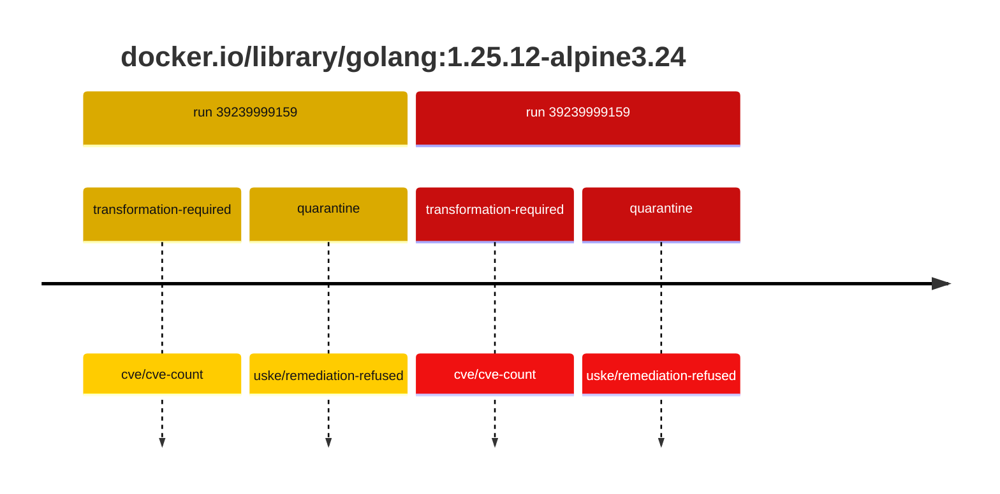
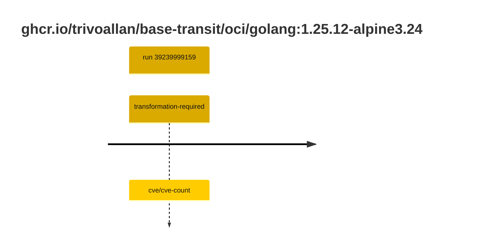

## golang-1 · docker.io/library/golang:1.25.12-alpine3.24

`sha256:56961d79ea8129efddcc0b8643fd8a5416b4e6228cfd477e3fd61deb2672c587`

| ts | run | state | reason | ruleset | report | details |
| --- | --- | --- | --- | --- | --- | --- |
| 2026-10-19T11:15:06Z | [39239999159](https://github.com/trivoallan/base-images/actions/runs/39239999159) | transformation-required | cve/cve-count | sha256:7d034c36a6153b33b76e2b2f7b4d84678e9d65039092cf8c67467d573f20ba84 | `results/reports/golang-1/sha256:56961d79ea8129efddcc0b8643fd8a5416b4e6228cfd477e3fd61deb2672c587/39239999159-1.md` | repairable: true |
| 2026-10-19T11:17:49Z | [39239999159](https://github.com/trivoallan/base-images/actions/runs/39239999159) | quarantine | uske/remediation-refused | sha256:7d034c36a6153b33b76e2b2f7b4d84678e9d65039092cf8c67467d573f20ba84 | `results/reports/golang-1/sha256:19d46b8dee32da01d0710bf342392b0180610443e7bcecdcbbc1a88f68fd5747/39239999159-1.md` | rebuilt: sha256:19d46b8dee32da01d0710bf342392b0180610443e7bcecdcbbc1a88f68fd5747 |

## golang-1 · ghcr.io/trivoallan/base-transit/oci/golang:1.25.12-alpine3.24

`sha256:19d46b8dee32da01d0710bf342392b0180610443e7bcecdcbbc1a88f68fd5747`

| ts | run | state | reason | ruleset | report | details |
| --- | --- | --- | --- | --- | --- | --- |
| 2026-10-19T11:17:49Z | [39239999159](https://github.com/trivoallan/base-images/actions/runs/39239999159) | transformation-required | cve/cve-count | sha256:7d034c36a6153b33b76e2b2f7b4d84678e9d65039092cf8c67467d573f20ba84 | `results/reports/golang-1/sha256:19d46b8dee32da01d0710bf342392b0180610443e7bcecdcbbc1a88f68fd5747/39239999159-1.md` | source: sha256:56961d79ea8129efddcc0b8643fd8a5416b4e6228cfd477e3fd61deb2672c587; epoch: 20261019T104819Z |

---

<!-- regis -->
# ghcr.io/trivoallan/base-transit/oci/golang:sha256:19d46b8dee32da01d0710bf342392b0180610443e7bcecdcbbc1a88f68fd5747

## 🏷️ Transformation requise puis placement · 57/100

**4/7 rules · 3 failed · worst: 🟥 critical**

| | Rule | Level | Result |
| --- | --- | --- | --- |
| ✗ | cve-critical | critical | Image has 28 critical CVEs (max allowed: 0). |
| ✗ | cve-fixable | warning | Image has 410 vulnerabilities with available fixes. |
| ✗ | cve-high | warning | Image has 306 high CVEs (max allowed: 10). |

**Analysis date:** 2026-10-19T11:17:49.011973+00:00

## Playbook results

| Playbook | Verdict | Failing rules |
| --- | --- | --- |
| Image reconstructible | 🏷️ Transformation requise puis placement · 57/100 | 3 |
