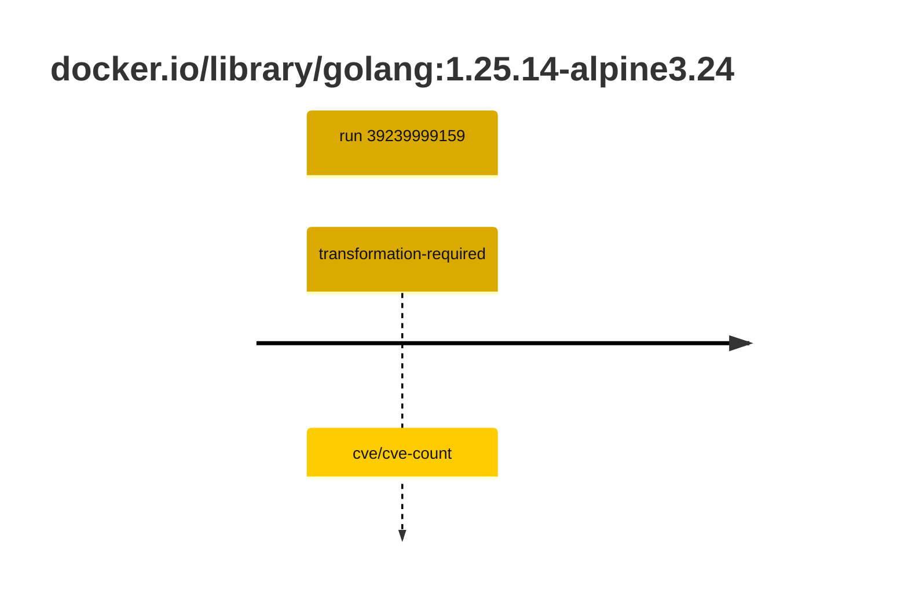

## golang-1 · docker.io/library/golang:1.25.14-alpine3.24

`sha256:1ae0735f00daffa3aaf1363a5184c0d2dc55c78e3db4ec70241cdac97bf84b59`

| ts | run | state | reason | ruleset | report | details |
| --- | --- | --- | --- | --- | --- | --- |
| 2026-10-19T11:15:40Z | [39239999159](https://github.com/trivoallan/base-images/actions/runs/39239999159) | transformation-required | cve/cve-count | sha256:7d034c36a6153b33b76e2b2f7b4d84678e9d65039092cf8c67467d573f20ba84 | `results/reports/golang-1/sha256:1ae0735f00daffa3aaf1363a5184c0d2dc55c78e3db4ec70241cdac97bf84b59/39239999159-1.md` | repairable: true |

---

<!-- regis -->
# docker.io/library/golang:sha256:1ae0735f00daffa3aaf1363a5184c0d2dc55c78e3db4ec70241cdac97bf84b59

## 🏷️ Transformation requise puis placement · 57/100

**4/7 rules · 3 failed · worst: 🟥 critical**

| | Rule | Level | Result |
| --- | --- | --- | --- |
| ✗ | cve-critical | critical | Image has 32 critical CVEs (max allowed: 0). |
| ✗ | cve-fixable | warning | Image has 288 vulnerabilities with available fixes. |
| ✗ | cve-high | warning | Image has 224 high CVEs (max allowed: 10). |

**Analysis date:** 2026-10-19T11:15:40.404940+00:00

## Playbook results

| Playbook | Verdict | Failing rules |
| --- | --- | --- |
| Image reconstructible | 🏷️ Transformation requise puis placement · 57/100 | 3 |
