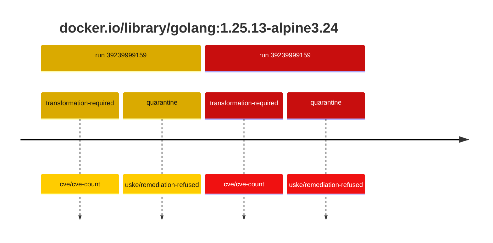
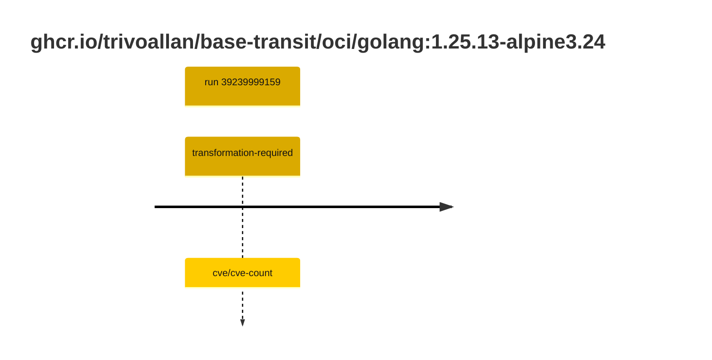

## golang-1 · docker.io/library/golang:1.25.13-alpine3.24

`sha256:1e0126852075c9c60731c8ba49088448b91f63e2aed97ca9d1a9791622a05946`

| ts | run | state | reason | ruleset | report | details |
| --- | --- | --- | --- | --- | --- | --- |
| 2026-10-19T11:15:24Z | [39239999159](https://github.com/trivoallan/base-images/actions/runs/39239999159) | transformation-required | cve/cve-count | sha256:7d034c36a6153b33b76e2b2f7b4d84678e9d65039092cf8c67467d573f20ba84 | `results/reports/golang-1/sha256:1e0126852075c9c60731c8ba49088448b91f63e2aed97ca9d1a9791622a05946/39239999159-1.md` | repairable: true |
| 2026-10-19T11:18:04Z | [39239999159](https://github.com/trivoallan/base-images/actions/runs/39239999159) | quarantine | uske/remediation-refused | sha256:7d034c36a6153b33b76e2b2f7b4d84678e9d65039092cf8c67467d573f20ba84 | `results/reports/golang-1/sha256:5cbea3deeec798091922d393df7aa61c72189e766fafeaee19c9f418605dc3dc/39239999159-1.md` | rebuilt: sha256:5cbea3deeec798091922d393df7aa61c72189e766fafeaee19c9f418605dc3dc |

## golang-1 · ghcr.io/trivoallan/base-transit/oci/golang:1.25.13-alpine3.24

`sha256:5cbea3deeec798091922d393df7aa61c72189e766fafeaee19c9f418605dc3dc`

| ts | run | state | reason | ruleset | report | details |
| --- | --- | --- | --- | --- | --- | --- |
| 2026-10-19T11:18:04Z | [39239999159](https://github.com/trivoallan/base-images/actions/runs/39239999159) | transformation-required | cve/cve-count | sha256:7d034c36a6153b33b76e2b2f7b4d84678e9d65039092cf8c67467d573f20ba84 | `results/reports/golang-1/sha256:5cbea3deeec798091922d393df7aa61c72189e766fafeaee19c9f418605dc3dc/39239999159-1.md` | source: sha256:1e0126852075c9c60731c8ba49088448b91f63e2aed97ca9d1a9791622a05946; epoch: 20261019T104819Z |

---

<!-- regis -->
# docker.io/library/golang:sha256:1e0126852075c9c60731c8ba49088448b91f63e2aed97ca9d1a9791622a05946

## 🏷️ Transformation requise puis placement · 57/100

**4/7 rules · 3 failed · worst: 🟥 critical**

| | Rule | Level | Result |
| --- | --- | --- | --- |
| ✗ | cve-critical | critical | Image has 32 critical CVEs (max allowed: 0). |
| ✗ | cve-fixable | warning | Image has 288 vulnerabilities with available fixes. |
| ✗ | cve-high | warning | Image has 224 high CVEs (max allowed: 10). |

**Analysis date:** 2026-10-19T11:15:23.517487+00:00

## Playbook results

| Playbook | Verdict | Failing rules |
| --- | --- | --- |
| Image reconstructible | 🏷️ Transformation requise puis placement · 57/100 | 3 |
