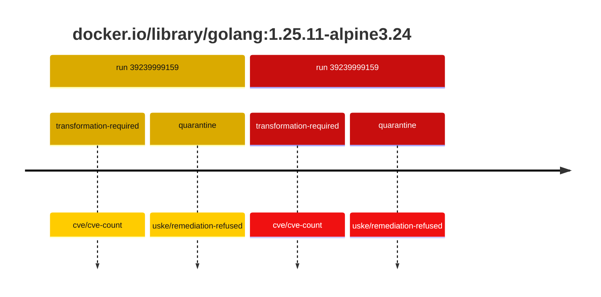
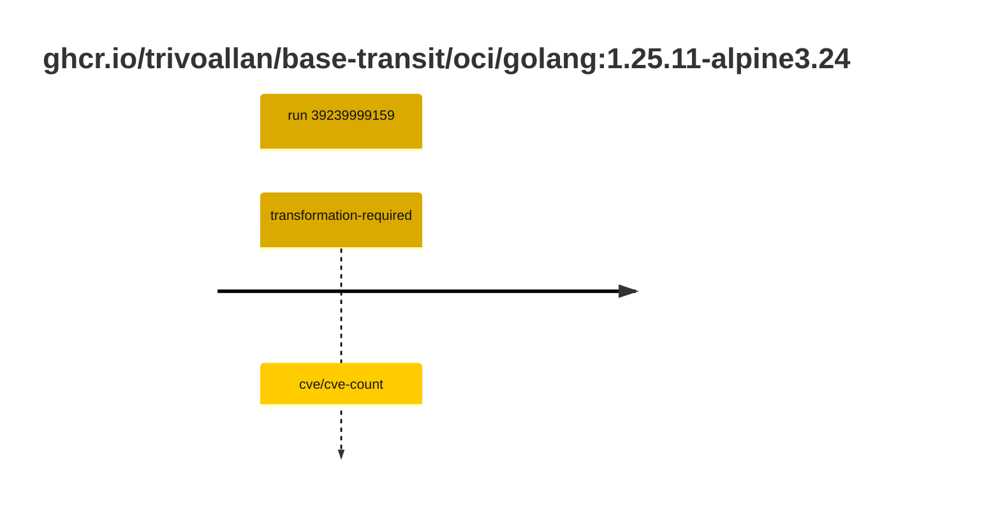

## golang-1 · docker.io/library/golang:1.25.11-alpine3.24

`sha256:523c3effe300580ed375e43f43b1c9b091b68e935a7c3a92bfcc4e7ed55b18c2`

| ts | run | state | reason | ruleset | report | details |
| --- | --- | --- | --- | --- | --- | --- |
| 2026-10-19T11:14:49Z | [39239999159](https://github.com/trivoallan/base-images/actions/runs/39239999159) | transformation-required | cve/cve-count | sha256:7d034c36a6153b33b76e2b2f7b4d84678e9d65039092cf8c67467d573f20ba84 | `results/reports/golang-1/sha256:523c3effe300580ed375e43f43b1c9b091b68e935a7c3a92bfcc4e7ed55b18c2/39239999159-1.md` | repairable: true |
| 2026-10-19T11:17:35Z | [39239999159](https://github.com/trivoallan/base-images/actions/runs/39239999159) | quarantine | uske/remediation-refused | sha256:7d034c36a6153b33b76e2b2f7b4d84678e9d65039092cf8c67467d573f20ba84 | `results/reports/golang-1/sha256:c181153d8d181be459b9ef20997702f41d767d131d39964e4ec273b8003102cf/39239999159-1.md` | rebuilt: sha256:c181153d8d181be459b9ef20997702f41d767d131d39964e4ec273b8003102cf |

## golang-1 · ghcr.io/trivoallan/base-transit/oci/golang:1.25.11-alpine3.24

`sha256:c181153d8d181be459b9ef20997702f41d767d131d39964e4ec273b8003102cf`

| ts | run | state | reason | ruleset | report | details |
| --- | --- | --- | --- | --- | --- | --- |
| 2026-10-19T11:17:35Z | [39239999159](https://github.com/trivoallan/base-images/actions/runs/39239999159) | transformation-required | cve/cve-count | sha256:7d034c36a6153b33b76e2b2f7b4d84678e9d65039092cf8c67467d573f20ba84 | `results/reports/golang-1/sha256:c181153d8d181be459b9ef20997702f41d767d131d39964e4ec273b8003102cf/39239999159-1.md` | source: sha256:523c3effe300580ed375e43f43b1c9b091b68e935a7c3a92bfcc4e7ed55b18c2; epoch: 20261019T104819Z |

---

<!-- regis -->
# docker.io/library/golang:sha256:523c3effe300580ed375e43f43b1c9b091b68e935a7c3a92bfcc4e7ed55b18c2

## 🏷️ Transformation requise puis placement · 43/100

**3/7 rules · 4 failed · worst: 🟥 critical**

| | Rule | Level | Result |
| --- | --- | --- | --- |
| ✗ | cve-critical | critical | Image has 32 critical CVEs (max allowed: 0). |
| ✗ | cve-fixable | warning | Image has 469 vulnerabilities with available fixes. |
| ✗ | cve-high | warning | Image has 348 high CVEs (max allowed: 10). |
| ✗ | freshness | warning | Image is older than 90 days (125 days). |

**Analysis date:** 2026-10-19T11:14:48.686067+00:00

## Playbook results

| Playbook | Verdict | Failing rules |
| --- | --- | --- |
| Image reconstructible | 🏷️ Transformation requise puis placement · 43/100 | 4 |
