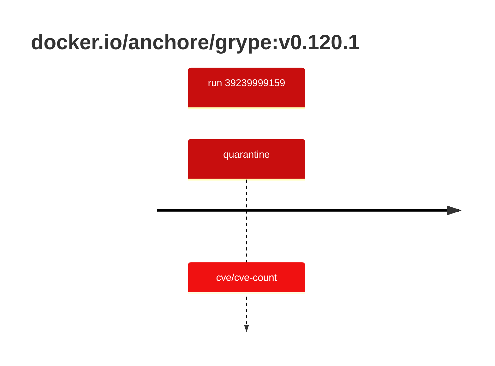

## grype-0 · docker.io/anchore/grype:v0.120.1

`sha256:e4a44ef45d285b829ce6efe2642980329661bd2d18eab5fc539138d4adaebbbe`

| ts | run | state | reason | ruleset | report | details |
| --- | --- | --- | --- | --- | --- | --- |
| 2026-10-19T10:56:33Z | [39239999159](https://github.com/trivoallan/base-images/actions/runs/39239999159) | quarantine | cve/cve-count | sha256:0936ffb81cdaa3596af399bfa54a5c6b9171416996ea31b39bc77dab6a8c1585 | `results/reports/grype-0/sha256:e4a44ef45d285b829ce6efe2642980329661bd2d18eab5fc539138d4adaebbbe/39239999159-1.md` |  |

---

<!-- regis -->
# docker.io/anchore/grype:sha256:e4a44ef45d285b829ce6efe2642980329661bd2d18eab5fc539138d4adaebbbe

## 🏷️ Quarantaine · 67/100

**4/6 rules · 2 failed · worst: 🟥 critical**

| | Rule | Level | Result |
| --- | --- | --- | --- |
| ✗ | cve-critical | critical | Image has 5 critical CVEs (max allowed: 0). |
| ✗ | cve-high | warning | Image has 27 high CVEs (max allowed: 10). |

**Analysis date:** 2026-10-19T10:56:33.431054+00:00

## Playbook results

| Playbook | Verdict | Failing rules |
| --- | --- | --- |
| Image copiée | 🏷️ Quarantaine · 67/100 | 2 |
