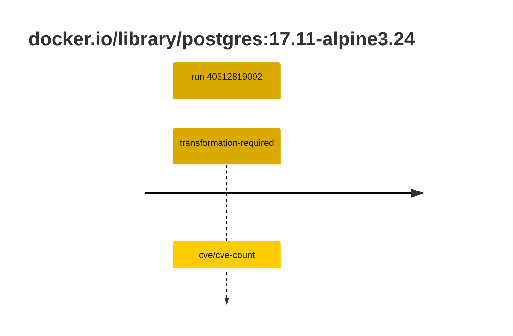

## postgres-17 · docker.io/library/postgres:17.11-alpine3.24

`sha256:266d3c257594e195b309ae9d1805e54c788f1d7b375f56bf6c367aac6c917e7b`

| ts | run | state | reason | ruleset | report | details |
| --- | --- | --- | --- | --- | --- | --- |
| 2026-10-26T11:28:29Z | [40312819092](https://github.com/trivoallan/base-images/actions/runs/40312819092) | transformation-required | cve/cve-count | sha256:7d034c36a6153b33b76e2b2f7b4d84678e9d65039092cf8c67467d573f20ba84 | `results/reports/postgres-17/sha256:266d3c257594e195b309ae9d1805e54c788f1d7b375f56bf6c367aac6c917e7b/40312819092-1.md` | repairable: true |

---

<!-- regis -->
# docker.io/library/postgres:sha256:266d3c257594e195b309ae9d1805e54c788f1d7b375f56bf6c367aac6c917e7b

## 🏷️ Transformation requise puis placement · 57/100

**4/7 rules · 3 failed · worst: 🟥 critical**

| | Rule | Level | Result |
| --- | --- | --- | --- |
| ✗ | cve-critical | critical | Image has 6 critical CVEs (max allowed: 0). |
| ✗ | cve-fixable | warning | Image has 130 vulnerabilities with available fixes. |
| ✗ | cve-high | warning | Image has 73 high CVEs (max allowed: 10). |

**Analysis date:** 2026-10-26T11:28:29.205299+00:00

## Playbook results

| Playbook | Verdict | Failing rules |
| --- | --- | --- |
| Image reconstructible | 🏷️ Transformation requise puis placement · 57/100 | 3 |
