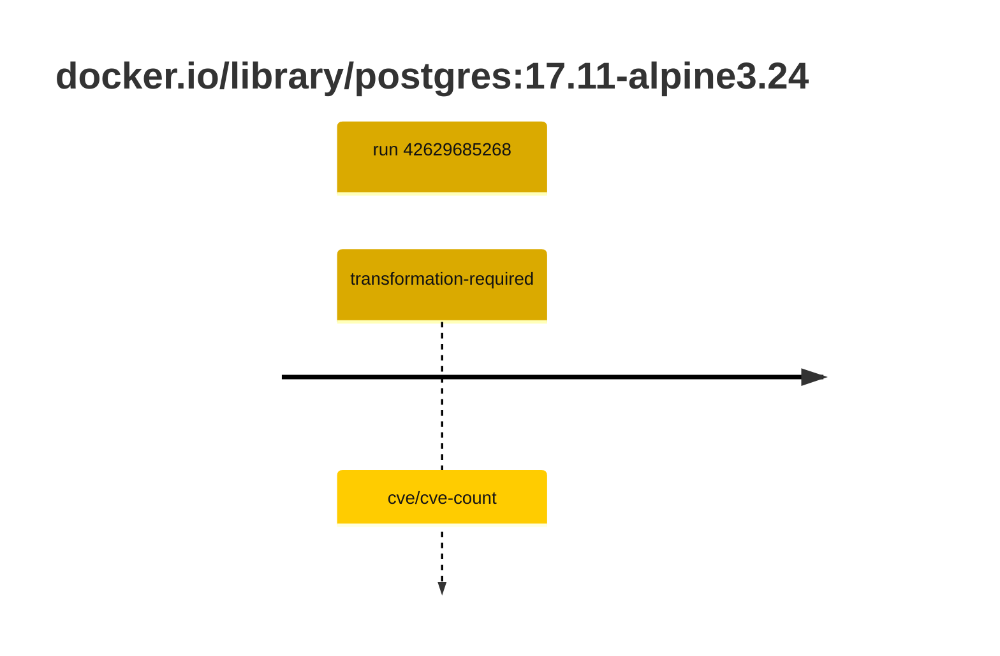

## postgres-17 · docker.io/library/postgres:17.11-alpine3.24

`sha256:3540c0362c809df084ffac0ae69fe794515f9de92692f02178bcdce0ef0302ac`

| ts | run | state | reason | ruleset | report | details |
| --- | --- | --- | --- | --- | --- | --- |
| 2026-11-09T14:13:33Z | [42629685268](https://github.com/trivoallan/base-images/actions/runs/42629685268) | transformation-required | cve/cve-count | sha256:7d034c36a6153b33b76e2b2f7b4d84678e9d65039092cf8c67467d573f20ba84 | `results/reports/postgres-17/sha256:3540c0362c809df084ffac0ae69fe794515f9de92692f02178bcdce0ef0302ac/42629685268-1.md` | repairable: true |

---

<!-- regis -->
# docker.io/library/postgres:sha256:3540c0362c809df084ffac0ae69fe794515f9de92692f02178bcdce0ef0302ac

## 🏷️ Transformation requise puis placement · 57/100

**4/7 rules · 3 failed · worst: 🟥 critical**

| | Rule | Level | Result |
| --- | --- | --- | --- |
| ✗ | cve-critical | critical | Image has 7 critical CVEs (max allowed: 0). |
| ✗ | cve-fixable | warning | Image has 132 vulnerabilities with available fixes. |
| ✗ | cve-high | warning | Image has 73 high CVEs (max allowed: 10). |

**Analysis date:** 2026-11-09T14:13:32.960126+00:00

## Playbook results

| Playbook | Verdict | Failing rules |
| --- | --- | --- |
| Image reconstructible | 🏷️ Transformation requise puis placement · 57/100 | 3 |
