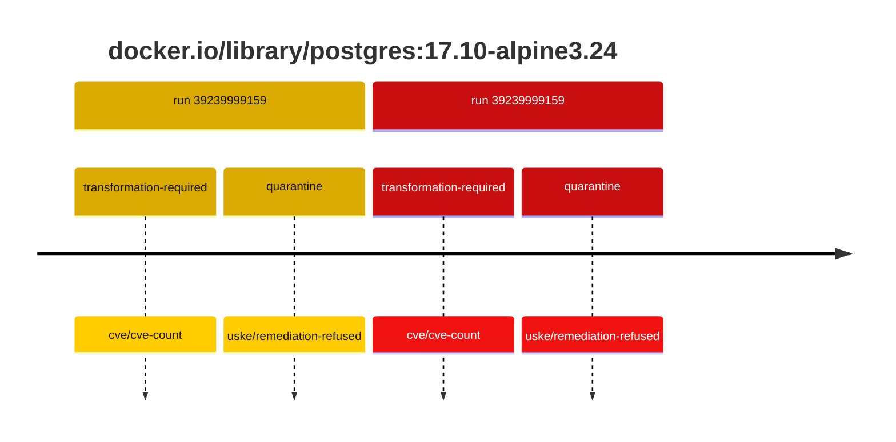
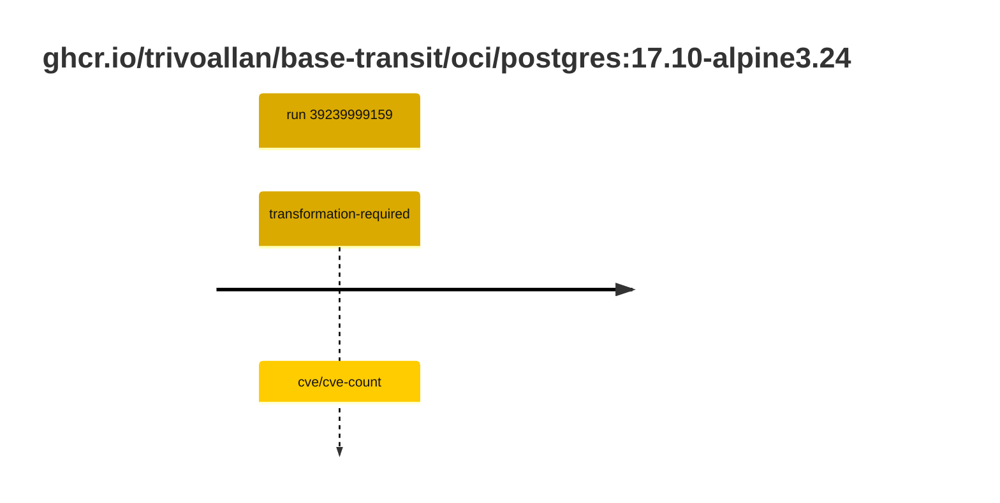

## postgres-17 · docker.io/library/postgres:17.10-alpine3.24

`sha256:742f40ea20b9ff2ff31db5458d127452988a2164df9e17441e191f3b72252193`

| ts | run | state | reason | ruleset | report | details |
| --- | --- | --- | --- | --- | --- | --- |
| 2026-10-19T11:18:44Z | [39239999159](https://github.com/trivoallan/base-images/actions/runs/39239999159) | transformation-required | cve/cve-count | sha256:7d034c36a6153b33b76e2b2f7b4d84678e9d65039092cf8c67467d573f20ba84 | `results/reports/postgres-17/sha256:742f40ea20b9ff2ff31db5458d127452988a2164df9e17441e191f3b72252193/39239999159-1.md` | repairable: true |
| 2026-10-19T11:20:41Z | [39239999159](https://github.com/trivoallan/base-images/actions/runs/39239999159) | quarantine | uske/remediation-refused | sha256:7d034c36a6153b33b76e2b2f7b4d84678e9d65039092cf8c67467d573f20ba84 | `results/reports/postgres-17/sha256:3cd7e13629c18a535b6b6127db7db37c0c17511c1dd1dec69a126d80c2e0f256/39239999159-1.md` | rebuilt: sha256:3cd7e13629c18a535b6b6127db7db37c0c17511c1dd1dec69a126d80c2e0f256 |

## postgres-17 · ghcr.io/trivoallan/base-transit/oci/postgres:17.10-alpine3.24

`sha256:3cd7e13629c18a535b6b6127db7db37c0c17511c1dd1dec69a126d80c2e0f256`

| ts | run | state | reason | ruleset | report | details |
| --- | --- | --- | --- | --- | --- | --- |
| 2026-10-19T11:20:41Z | [39239999159](https://github.com/trivoallan/base-images/actions/runs/39239999159) | transformation-required | cve/cve-count | sha256:7d034c36a6153b33b76e2b2f7b4d84678e9d65039092cf8c67467d573f20ba84 | `results/reports/postgres-17/sha256:3cd7e13629c18a535b6b6127db7db37c0c17511c1dd1dec69a126d80c2e0f256/39239999159-1.md` | source: sha256:742f40ea20b9ff2ff31db5458d127452988a2164df9e17441e191f3b72252193; epoch: 20261019T104819Z |

---

<!-- regis -->
# ghcr.io/trivoallan/base-transit/oci/postgres:sha256:3cd7e13629c18a535b6b6127db7db37c0c17511c1dd1dec69a126d80c2e0f256

## 🏷️ Transformation requise puis placement · 57/100

**4/7 rules · 3 failed · worst: 🟥 critical**

| | Rule | Level | Result |
| --- | --- | --- | --- |
| ✗ | cve-critical | critical | Image has 6 critical CVEs (max allowed: 0). |
| ✗ | cve-fixable | warning | Image has 154 vulnerabilities with available fixes. |
| ✗ | cve-high | warning | Image has 89 high CVEs (max allowed: 10). |

**Analysis date:** 2026-10-19T11:20:41.068224+00:00

## Playbook results

| Playbook | Verdict | Failing rules |
| --- | --- | --- |
| Image reconstructible | 🏷️ Transformation requise puis placement · 57/100 | 3 |
