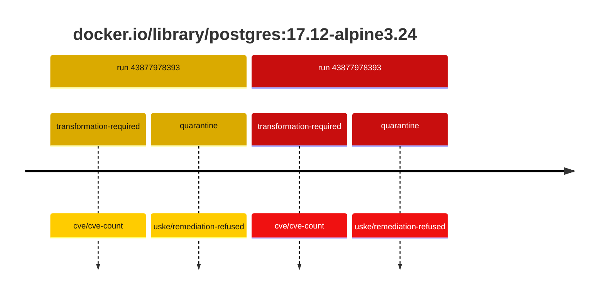
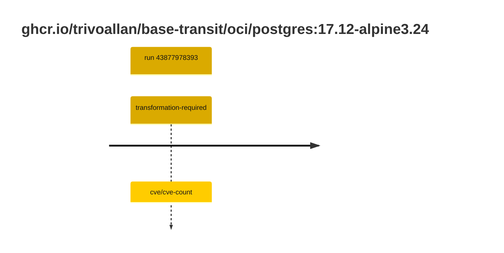

## postgres-17 · docker.io/library/postgres:17.12-alpine3.24

`sha256:a77aa70e641402a21411b92b721c58d10f23b50ae5fdd2333efd22d166e1e5f7`

| ts | run | state | reason | ruleset | report | details |
| --- | --- | --- | --- | --- | --- | --- |
| 2026-11-16T13:52:47Z | [43877978393](https://github.com/trivoallan/base-images/actions/runs/43877978393) | transformation-required | cve/cve-count | sha256:7d034c36a6153b33b76e2b2f7b4d84678e9d65039092cf8c67467d573f20ba84 | `results/reports/postgres-17/sha256:a77aa70e641402a21411b92b721c58d10f23b50ae5fdd2333efd22d166e1e5f7/43877978393-1.md` | repairable: true |
| 2026-11-16T13:54:55Z | [43877978393](https://github.com/trivoallan/base-images/actions/runs/43877978393) | quarantine | uske/remediation-refused | sha256:7d034c36a6153b33b76e2b2f7b4d84678e9d65039092cf8c67467d573f20ba84 | `results/reports/postgres-17/sha256:780d0b0796e271cf856a1a3580bb944b7eda9d91b9ab5482a64422711cb32974/43877978393-1.md` | rebuilt: sha256:780d0b0796e271cf856a1a3580bb944b7eda9d91b9ab5482a64422711cb32974 |

## postgres-17 · ghcr.io/trivoallan/base-transit/oci/postgres:17.12-alpine3.24

`sha256:780d0b0796e271cf856a1a3580bb944b7eda9d91b9ab5482a64422711cb32974`

| ts | run | state | reason | ruleset | report | details |
| --- | --- | --- | --- | --- | --- | --- |
| 2026-11-16T13:54:55Z | [43877978393](https://github.com/trivoallan/base-images/actions/runs/43877978393) | transformation-required | cve/cve-count | sha256:7d034c36a6153b33b76e2b2f7b4d84678e9d65039092cf8c67467d573f20ba84 | `results/reports/postgres-17/sha256:780d0b0796e271cf856a1a3580bb944b7eda9d91b9ab5482a64422711cb32974/43877978393-1.md` | source: sha256:a77aa70e641402a21411b92b721c58d10f23b50ae5fdd2333efd22d166e1e5f7; epoch: 20261116T134038Z |

---

<!-- regis -->
# ghcr.io/trivoallan/base-transit/oci/postgres:sha256:780d0b0796e271cf856a1a3580bb944b7eda9d91b9ab5482a64422711cb32974

## 🏷️ Transformation requise puis placement · 57/100

**4/7 rules · 3 failed · worst: 🟥 critical**

| | Rule | Level | Result |
| --- | --- | --- | --- |
| ✗ | cve-critical | critical | Image has 6 critical CVEs (max allowed: 0). |
| ✗ | cve-fixable | warning | Image has 132 vulnerabilities with available fixes. |
| ✗ | cve-high | warning | Image has 73 high CVEs (max allowed: 10). |

**Analysis date:** 2026-11-16T13:54:55.135791+00:00

## Playbook results

| Playbook | Verdict | Failing rules |
| --- | --- | --- |
| Image reconstructible | 🏷️ Transformation requise puis placement · 57/100 | 3 |
