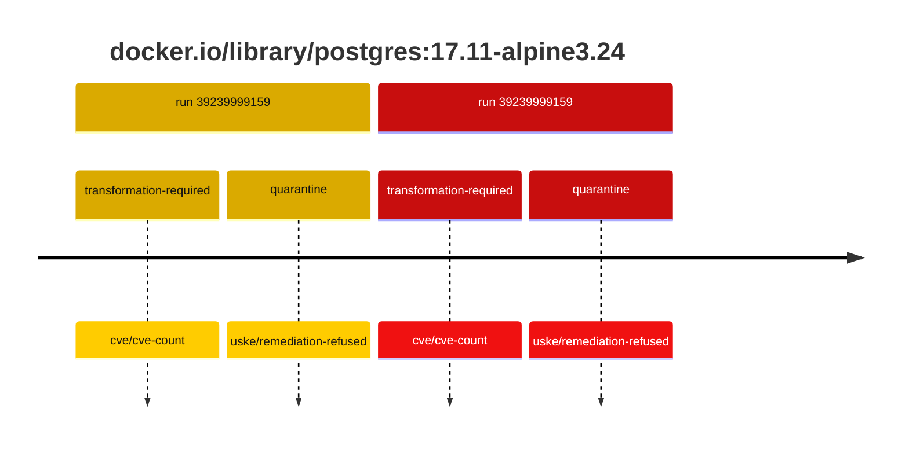
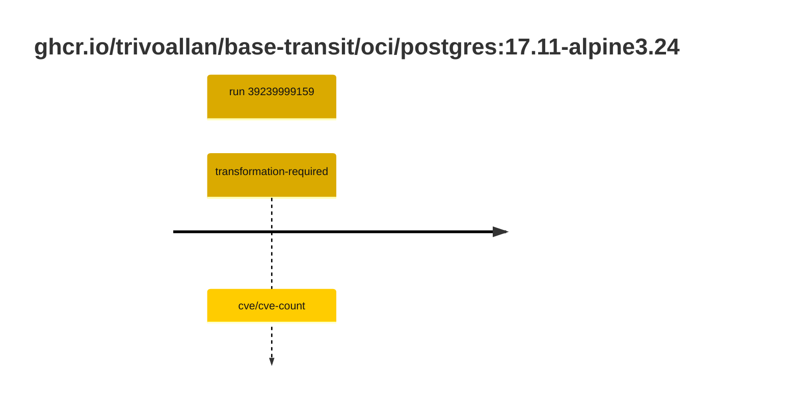

## postgres-17 · docker.io/library/postgres:17.11-alpine3.24

`sha256:b0f9560a2de083e2cc7382e75f808c7381a32852a7ec49117deedb300e552b24`

| ts | run | state | reason | ruleset | report | details |
| --- | --- | --- | --- | --- | --- | --- |
| 2026-10-19T11:19:01Z | [39239999159](https://github.com/trivoallan/base-images/actions/runs/39239999159) | transformation-required | cve/cve-count | sha256:7d034c36a6153b33b76e2b2f7b4d84678e9d65039092cf8c67467d573f20ba84 | `results/reports/postgres-17/sha256:b0f9560a2de083e2cc7382e75f808c7381a32852a7ec49117deedb300e552b24/39239999159-1.md` | repairable: true |
| 2026-10-19T11:20:57Z | [39239999159](https://github.com/trivoallan/base-images/actions/runs/39239999159) | quarantine | uske/remediation-refused | sha256:7d034c36a6153b33b76e2b2f7b4d84678e9d65039092cf8c67467d573f20ba84 | `results/reports/postgres-17/sha256:5f1f063e67c3d93d4bed7c6a4e56dcf382ea1f0b112689fd7ead8ab5150c0a7e/39239999159-1.md` | rebuilt: sha256:5f1f063e67c3d93d4bed7c6a4e56dcf382ea1f0b112689fd7ead8ab5150c0a7e |

## postgres-17 · ghcr.io/trivoallan/base-transit/oci/postgres:17.11-alpine3.24

`sha256:5f1f063e67c3d93d4bed7c6a4e56dcf382ea1f0b112689fd7ead8ab5150c0a7e`

| ts | run | state | reason | ruleset | report | details |
| --- | --- | --- | --- | --- | --- | --- |
| 2026-10-19T11:20:57Z | [39239999159](https://github.com/trivoallan/base-images/actions/runs/39239999159) | transformation-required | cve/cve-count | sha256:7d034c36a6153b33b76e2b2f7b4d84678e9d65039092cf8c67467d573f20ba84 | `results/reports/postgres-17/sha256:5f1f063e67c3d93d4bed7c6a4e56dcf382ea1f0b112689fd7ead8ab5150c0a7e/39239999159-1.md` | source: sha256:b0f9560a2de083e2cc7382e75f808c7381a32852a7ec49117deedb300e552b24; epoch: 20261019T104819Z |

---

<!-- regis -->
# docker.io/library/postgres:sha256:b0f9560a2de083e2cc7382e75f808c7381a32852a7ec49117deedb300e552b24

## 🏷️ Transformation requise puis placement · 57/100

**4/7 rules · 3 failed · worst: 🟥 critical**

| | Rule | Level | Result |
| --- | --- | --- | --- |
| ✗ | cve-critical | critical | Image has 6 critical CVEs (max allowed: 0). |
| ✗ | cve-fixable | warning | Image has 130 vulnerabilities with available fixes. |
| ✗ | cve-high | warning | Image has 82 high CVEs (max allowed: 10). |

**Analysis date:** 2026-10-19T11:19:00.794565+00:00

## Playbook results

| Playbook | Verdict | Failing rules |
| --- | --- | --- |
| Image reconstructible | 🏷️ Transformation requise puis placement · 57/100 | 3 |
