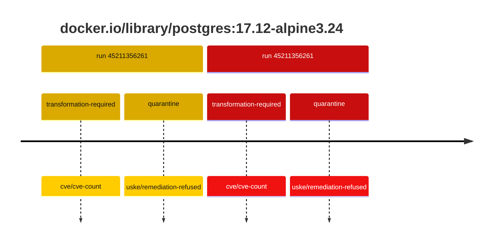
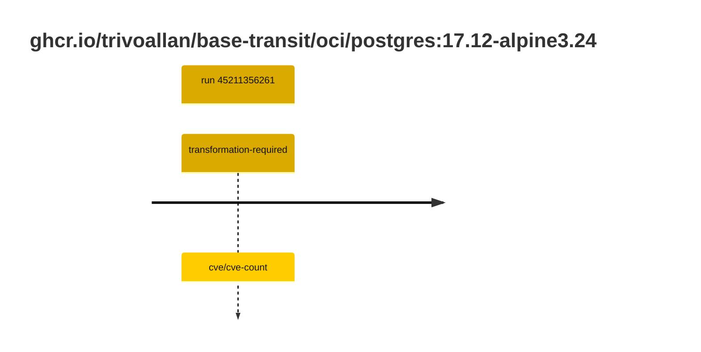

## postgres-17 · docker.io/library/postgres:17.12-alpine3.24

`sha256:f9cf3e1f0066f0eb0c48707d864f0ac5941e9ff454a072077d97a4d278d07d73`

| ts | run | state | reason | ruleset | report | details |
| --- | --- | --- | --- | --- | --- | --- |
| 2026-11-23T16:13:17Z | [45211356261](https://github.com/trivoallan/base-images/actions/runs/45211356261) | transformation-required | cve/cve-count | sha256:7d034c36a6153b33b76e2b2f7b4d84678e9d65039092cf8c67467d573f20ba84 | `results/reports/postgres-17/sha256:f9cf3e1f0066f0eb0c48707d864f0ac5941e9ff454a072077d97a4d278d07d73/45211356261-1.md` | repairable: true |
| 2026-11-23T16:15:29Z | [45211356261](https://github.com/trivoallan/base-images/actions/runs/45211356261) | quarantine | uske/remediation-refused | sha256:7d034c36a6153b33b76e2b2f7b4d84678e9d65039092cf8c67467d573f20ba84 | `results/reports/postgres-17/sha256:5f61ef35da3c3956363340b902e28c210a7116b19fe861351be1edc7c67e528e/45211356261-1.md` | rebuilt: sha256:5f61ef35da3c3956363340b902e28c210a7116b19fe861351be1edc7c67e528e |

## postgres-17 · ghcr.io/trivoallan/base-transit/oci/postgres:17.12-alpine3.24

`sha256:5f61ef35da3c3956363340b902e28c210a7116b19fe861351be1edc7c67e528e`

| ts | run | state | reason | ruleset | report | details |
| --- | --- | --- | --- | --- | --- | --- |
| 2026-11-23T16:15:29Z | [45211356261](https://github.com/trivoallan/base-images/actions/runs/45211356261) | transformation-required | cve/cve-count | sha256:7d034c36a6153b33b76e2b2f7b4d84678e9d65039092cf8c67467d573f20ba84 | `results/reports/postgres-17/sha256:5f61ef35da3c3956363340b902e28c210a7116b19fe861351be1edc7c67e528e/45211356261-1.md` | source: sha256:f9cf3e1f0066f0eb0c48707d864f0ac5941e9ff454a072077d97a4d278d07d73; epoch: 20261123T160001Z |

---

<!-- regis -->
# docker.io/library/postgres:sha256:f9cf3e1f0066f0eb0c48707d864f0ac5941e9ff454a072077d97a4d278d07d73

## 🏷️ Transformation requise puis placement · 57/100

**4/7 rules · 3 failed · worst: 🟥 critical**

| | Rule | Level | Result |
| --- | --- | --- | --- |
| ✗ | cve-critical | critical | Image has 6 critical CVEs (max allowed: 0). |
| ✗ | cve-fixable | warning | Image has 151 vulnerabilities with available fixes. |
| ✗ | cve-high | warning | Image has 100 high CVEs (max allowed: 10). |

**Analysis date:** 2026-11-23T16:13:17.044739+00:00

## Playbook results

| Playbook | Verdict | Failing rules |
| --- | --- | --- |
| Image reconstructible | 🏷️ Transformation requise puis placement · 57/100 | 3 |
