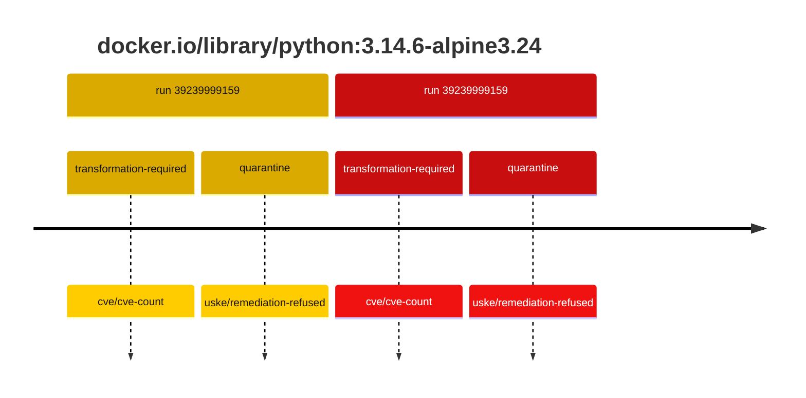
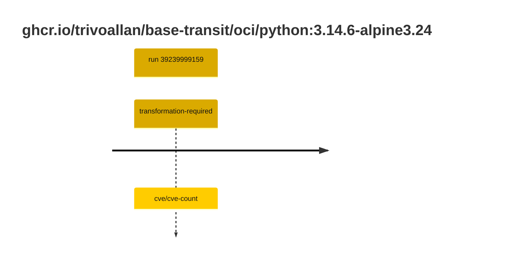

## python-3 · docker.io/library/python:3.14.6-alpine3.24

`sha256:26730869004e2b9c4b9ad09cab8625e81d256d1ce97e72df5520e806b1709f92`

| ts | run | state | reason | ruleset | report | details |
| --- | --- | --- | --- | --- | --- | --- |
| 2026-10-19T11:21:18Z | [39239999159](https://github.com/trivoallan/base-images/actions/runs/39239999159) | transformation-required | cve/cve-count | sha256:7d034c36a6153b33b76e2b2f7b4d84678e9d65039092cf8c67467d573f20ba84 | `results/reports/python-3/sha256:26730869004e2b9c4b9ad09cab8625e81d256d1ce97e72df5520e806b1709f92/39239999159-1.md` | repairable: true |
| 2026-10-19T11:23:05Z | [39239999159](https://github.com/trivoallan/base-images/actions/runs/39239999159) | quarantine | uske/remediation-refused | sha256:7d034c36a6153b33b76e2b2f7b4d84678e9d65039092cf8c67467d573f20ba84 | `results/reports/python-3/sha256:1169624ee936eca41b50a32c6db4424f1af89fb30d949523e462c7472e2d3aa5/39239999159-1.md` | rebuilt: sha256:1169624ee936eca41b50a32c6db4424f1af89fb30d949523e462c7472e2d3aa5 |

## python-3 · ghcr.io/trivoallan/base-transit/oci/python:3.14.6-alpine3.24

`sha256:1169624ee936eca41b50a32c6db4424f1af89fb30d949523e462c7472e2d3aa5`

| ts | run | state | reason | ruleset | report | details |
| --- | --- | --- | --- | --- | --- | --- |
| 2026-10-19T11:23:05Z | [39239999159](https://github.com/trivoallan/base-images/actions/runs/39239999159) | transformation-required | cve/cve-count | sha256:7d034c36a6153b33b76e2b2f7b4d84678e9d65039092cf8c67467d573f20ba84 | `results/reports/python-3/sha256:1169624ee936eca41b50a32c6db4424f1af89fb30d949523e462c7472e2d3aa5/39239999159-1.md` | source: sha256:26730869004e2b9c4b9ad09cab8625e81d256d1ce97e72df5520e806b1709f92; epoch: 20261019T104819Z |

---

<!-- regis -->
# docker.io/library/python:sha256:26730869004e2b9c4b9ad09cab8625e81d256d1ce97e72df5520e806b1709f92

## 🏷️ Transformation requise puis placement · 43/100

**3/7 rules · 4 failed · worst: 🟥 critical**

| | Rule | Level | Result |
| --- | --- | --- | --- |
| ✗ | cve-critical | critical | Image has 5 critical CVEs (max allowed: 0). |
| ✗ | cve-fixable | warning | Image has 47 vulnerabilities with available fixes. |
| ✗ | cve-high | warning | Image has 34 high CVEs (max allowed: 10). |
| ✗ | freshness | warning | Image is older than 90 days (125 days). |

**Analysis date:** 2026-10-19T11:21:18.248644+00:00

## Playbook results

| Playbook | Verdict | Failing rules |
| --- | --- | --- |
| Image reconstructible | 🏷️ Transformation requise puis placement · 43/100 | 4 |
