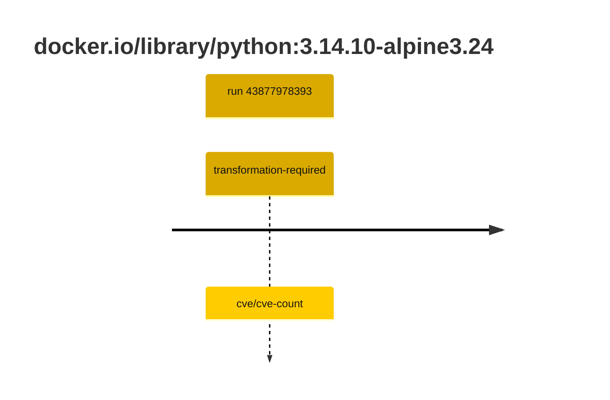

## python-3 · docker.io/library/python:3.14.10-alpine3.24

`sha256:5862d971d1f0ae26b258cefa4e893556b1d3aba81bd2ff30888704ad378bab67`

| ts | run | state | reason | ruleset | report | details |
| --- | --- | --- | --- | --- | --- | --- |
| 2026-11-16T13:55:25Z | [43877978393](https://github.com/trivoallan/base-images/actions/runs/43877978393) | transformation-required | cve/cve-count | sha256:7d034c36a6153b33b76e2b2f7b4d84678e9d65039092cf8c67467d573f20ba84 | `results/reports/python-3/sha256:5862d971d1f0ae26b258cefa4e893556b1d3aba81bd2ff30888704ad378bab67/43877978393-1.md` | repairable: true |

---

<!-- regis -->
# docker.io/library/python:sha256:5862d971d1f0ae26b258cefa4e893556b1d3aba81bd2ff30888704ad378bab67

## 🏷️ Transformation requise puis placement · 71/100

**5/7 rules · 2 failed · worst: 🟥 critical**

| | Rule | Level | Result |
| --- | --- | --- | --- |
| ✗ | cve-critical | critical | Image has 1 critical CVEs (max allowed: 0). |
| ✗ | cve-fixable | warning | Image has 5 vulnerabilities with available fixes. |

**Analysis date:** 2026-11-16T13:55:24.515443+00:00

## Playbook results

| Playbook | Verdict | Failing rules |
| --- | --- | --- |
| Image reconstructible | 🏷️ Transformation requise puis placement · 71/100 | 2 |
