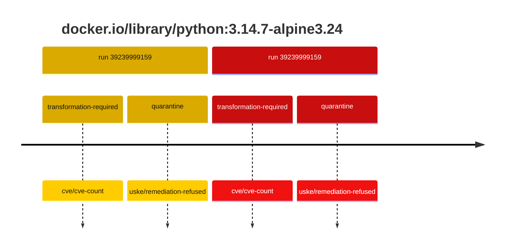
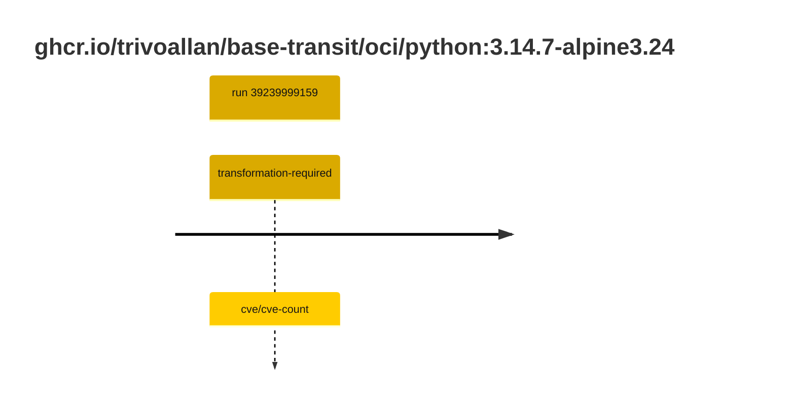

## python-3 · docker.io/library/python:3.14.7-alpine3.24

`sha256:9e9fde4d32eedce0b661d9ab91e826b62dddf28e928c230ec55f1866cac66b01`

| ts | run | state | reason | ruleset | report | details |
| --- | --- | --- | --- | --- | --- | --- |
| 2026-10-19T11:21:29Z | [39239999159](https://github.com/trivoallan/base-images/actions/runs/39239999159) | transformation-required | cve/cve-count | sha256:7d034c36a6153b33b76e2b2f7b4d84678e9d65039092cf8c67467d573f20ba84 | `results/reports/python-3/sha256:9e9fde4d32eedce0b661d9ab91e826b62dddf28e928c230ec55f1866cac66b01/39239999159-1.md` | repairable: true |
| 2026-10-19T11:23:19Z | [39239999159](https://github.com/trivoallan/base-images/actions/runs/39239999159) | quarantine | uske/remediation-refused | sha256:7d034c36a6153b33b76e2b2f7b4d84678e9d65039092cf8c67467d573f20ba84 | `results/reports/python-3/sha256:88ee2c6cb0c882553158b7ec664a9eb95bad1dac53321ba86cff1bc98f4af2eb/39239999159-1.md` | rebuilt: sha256:88ee2c6cb0c882553158b7ec664a9eb95bad1dac53321ba86cff1bc98f4af2eb |

## python-3 · ghcr.io/trivoallan/base-transit/oci/python:3.14.7-alpine3.24

`sha256:88ee2c6cb0c882553158b7ec664a9eb95bad1dac53321ba86cff1bc98f4af2eb`

| ts | run | state | reason | ruleset | report | details |
| --- | --- | --- | --- | --- | --- | --- |
| 2026-10-19T11:23:19Z | [39239999159](https://github.com/trivoallan/base-images/actions/runs/39239999159) | transformation-required | cve/cve-count | sha256:7d034c36a6153b33b76e2b2f7b4d84678e9d65039092cf8c67467d573f20ba84 | `results/reports/python-3/sha256:88ee2c6cb0c882553158b7ec664a9eb95bad1dac53321ba86cff1bc98f4af2eb/39239999159-1.md` | source: sha256:9e9fde4d32eedce0b661d9ab91e826b62dddf28e928c230ec55f1866cac66b01; epoch: 20261019T104819Z |

---

<!-- regis -->
# ghcr.io/trivoallan/base-transit/oci/python:sha256:88ee2c6cb0c882553158b7ec664a9eb95bad1dac53321ba86cff1bc98f4af2eb

## 🏷️ Transformation requise puis placement · 71/100

**5/7 rules · 2 failed · worst: 🟥 critical**

| | Rule | Level | Result |
| --- | --- | --- | --- |
| ✗ | cve-critical | critical | Image has 1 critical CVEs (max allowed: 0). |
| ✗ | cve-fixable | warning | Image has 8 vulnerabilities with available fixes. |

**Analysis date:** 2026-10-19T11:23:18.647276+00:00

## Playbook results

| Playbook | Verdict | Failing rules |
| --- | --- | --- |
| Image reconstructible | 🏷️ Transformation requise puis placement · 71/100 | 2 |
