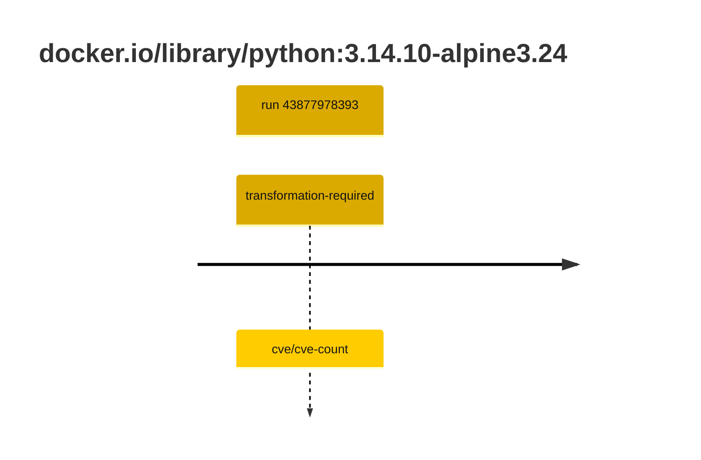
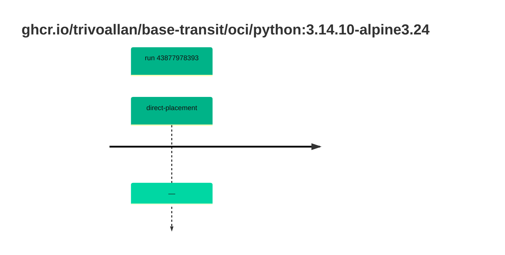

## python-3 · docker.io/library/python:3.14.10-alpine3.24

`sha256:5862d971d1f0ae26b258cefa4e893556b1d3aba81bd2ff30888704ad378bab67`

| ts | run | state | reason | ruleset | report | details |
| --- | --- | --- | --- | --- | --- | --- |
| 2026-11-16T13:55:25Z | [43877978393](https://github.com/trivoallan/base-images/actions/runs/43877978393) | transformation-required | cve/cve-count | sha256:7d034c36a6153b33b76e2b2f7b4d84678e9d65039092cf8c67467d573f20ba84 | `results/reports/python-3/sha256:5862d971d1f0ae26b258cefa4e893556b1d3aba81bd2ff30888704ad378bab67/43877978393-1.md` | repairable: true |

## python-3 · ghcr.io/trivoallan/base-transit/oci/python:3.14.10-alpine3.24

`sha256:b046182ac9c711836f7bfe62ab9dfa232849ff9591f070ec4ea64718f0d8accd`

| ts | run | state | reason | ruleset | report | details |
| --- | --- | --- | --- | --- | --- | --- |
| 2026-11-16T13:56:58Z | [43877978393](https://github.com/trivoallan/base-images/actions/runs/43877978393) | direct-placement | — | sha256:7d034c36a6153b33b76e2b2f7b4d84678e9d65039092cf8c67467d573f20ba84 | `results/reports/python-3/sha256:b046182ac9c711836f7bfe62ab9dfa232849ff9591f070ec4ea64718f0d8accd/43877978393-1.md` | source: sha256:5862d971d1f0ae26b258cefa4e893556b1d3aba81bd2ff30888704ad378bab67; epoch: 20261116T134038Z |

---

<!-- regis -->
# ghcr.io/trivoallan/base-transit/oci/python:sha256:b046182ac9c711836f7bfe62ab9dfa232849ff9591f070ec4ea64718f0d8accd

## 🏷️ Placement direct · 86/100

**6/7 rules · 1 failed · worst: 🟧 warning**

| | Rule | Level | Result |
| --- | --- | --- | --- |
| ✗ | cve-fixable | warning | Image has 4 vulnerabilities with available fixes. |

**Analysis date:** 2026-11-16T13:56:57.662984+00:00

## Playbook results

| Playbook | Verdict | Failing rules |
| --- | --- | --- |
| Image reconstructible | 🏷️ Placement direct · 86/100 | 1 |
